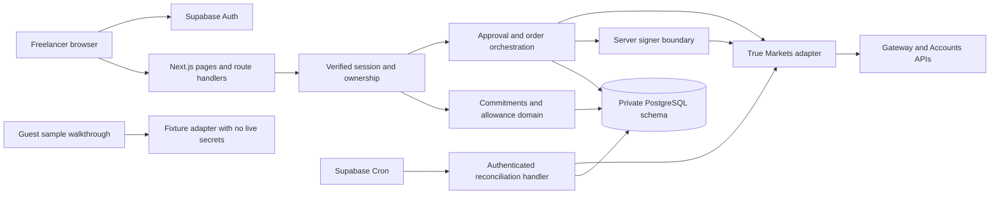

# Harborline Product, Architecture, and Implementation Plan

> For agentic workers: implement this plan task by task using `superpowers:executing-plans`, or `superpowers:subagent-driven-development` if that execution method is selected. Checkboxes track implementation, not work completed by writing this plan. Read the product specification in sections 1–8 before executing sections 13–16.

**Goal:** Help a freelancer receiving USDC understand the amount remaining after stated commitments and a chosen buffer, then explicitly approve a tokenized-asset investment through True Markets Gateway and inspect its outcome.

**Architecture:** A modular Next.js application, PostgreSQL, managed authentication, a server-only Gateway adapter, and a scheduled reconciliation handler. Financial calculations are pure domain functions; provider balances and execution records remain authoritative for actual funds and fills.

**Proposed stack:** TypeScript, Next.js App Router on the Node runtime, Tailwind CSS, accessible component primitives, Supabase Auth and PostgreSQL, Drizzle with PostgreSQL transactions, decimal.js, Vitest, Playwright, Vercel deployment, and Supabase Cron for periodic reconciliation. Pin compatible stable versions during setup; do not use unpinned dependencies in the submitted lockfile.

**Status:** Product planning and the local application baseline are verified. HL-01–03 are under PR review; their PR descriptions carry current publication state. Authentication, persistence, Gateway integration, deployment, and live proof remain unimplemented. Section 18 defines the detailed PR roadmap. Stack, scope, budgets, and time estimates are engineering recommendations, not approved infrastructure purchases.

**Prepared:** 23 November 2026. Research clock: approximately 10:54 UTC / 16:24 IST. **Deadline:** 29 November 2026, 23:59 UTC = **30 November 2026, 05:29 IST**. About 6 days 13 hours remained at that check. Internal submission target: **29 November, 18:00 IST**, leaving about 11½ hours of contingency.

## Contents

1. Product decision and success criteria
2. Evidence, rules, and unresolved conflicts
3. Scope and differentiation
4. User journey and interface specification
5. Money model and invariants
6. Provider integration contract
7. Architecture and operational boundaries
8. Order lifecycle and recovery
9. Data model
10. Application contracts
11. Proposed codebase structure
12. Security, deployment, and maintenance
13. Phased schedule and decision gates
14. Implementation tasks and acceptance tests
15. Submission package and demonstration
16. Risk register and decisions
17. Sources and research limits
18. PR delivery roadmap, labels, and progress tracking

## Global constraints

- Brand: **Harborline**; repository slug may be `harborline`. Working tagline: “Invest with room to breathe.” The name has not received trademark/domain clearance.
- Deadline: **2026-11-29T23:59:00Z**, with the earlier internal target above.
- All monetary and asset quantities cross JSON boundaries as decimal strings.
- No automatic investing, leverage, derivatives, portfolio recommendations, or predicted investment returns in the MVP.
- Start with one settlement network and one quote asset. **Proposed: native USDC on Solana**, conditional on the integration proof. Do not combine balances across networks.
- Use active, tradeable, `venue=defi`, `type=spot`, `asset_class=stock` listings with market support; explicitly request `venue: "defi"` during order creation.
- Real execution requires authenticated ownership, eligibility, a fresh calculation, exact-term approval, and enabled live-operation controls.
- Public walkthroughs use unmistakably labeled sample data and have no live credentials. A walkthrough is not evidence of live integration by itself.
- Approval to prepare this plan does not authorize funding, trading, paid provisioning, sending messages, committing, pushing, or submitting the entry.

## Review focus

Five high-impact cases must receive explicit tests in section 14:

1. A provider execute request succeeds but its response is lost: persist uncertainty and reconcile without another execution request.
2. Two tabs approve the same or different intents concurrently: serialize financial actions and avoid double spending through Harborline.
3. A commitment changes between review and approval: invalidate the old approval terms and require review again.
4. A quote returns HTTP 201 with no order ID, or returns an unexpected venue/state: do not display an executable order or sign blindly.
5. Available funds already exclude provider holds: do not subtract those holds again; block new orders while an earlier local action is unresolved.

## 1. Product decision and success criteria

### 1.1 The problem

A freelancer receives a variable USDC payment. Their wallet shows a balance, but that balance does not explain how much is needed for rent, subscriptions, taxes, or a buffer before their next reliable payment. Opening a trading app leaves them to calculate this manually and remember the consequences of investing.

Harborline connects a short cash-planning decision to an explicit investment action. It answers: **“Given the money confirmed in this wallet and the commitments I entered, how much room do I currently have to invest?”**

The first user is an adult freelancer already familiar with receiving USDC, using a supported jurisdiction and network. Demand, willingness to deposit into a Gateway wallet, and willingness to trust this workflow remain hypotheses. Do not market globally before eligibility and operating responsibilities are confirmed.

### 1.2 The complete first workflow

Confirmed wallet balance → enter upcoming commitments and additional buffer → inspect the calculation → choose a supported tokenized asset and amount → review terms and acknowledge exposure → explicitly approve → inspect status and reconciled receipt.

The allowance is a calculation from limited information, not suitability advice or a guarantee that investing is safe. Missing obligations, stablecoin risk, token issuer risk, volatility, and off-ramp timing remain real limitations. The app does not pay bills or provide fiat liquidity.

### 1.3 Differentiation

The signature interaction is a **before-and-after cash explanation** beside order review: “This purchase would leave X USDC, with Y allocated in your plan to upcoming commitments and Z as your additional buffer.” A dated receipt preserves the calculation and the trade the user approved.

A meaningful “do not invest yet” result is part of the product. It should explain the shortfall and the inputs that caused it without suggesting that the user lower essential commitments to unlock trading.

### 1.4 Alternatives considered

| Approach | Benefit | Cost | Decision |
| --- | --- | --- | --- |
| Cash planning plus user-approved investment | Clear problem, visible sponsor integration, testable decision | Requires balance and execution correctness | Recommended |
| AI financial advisor with portfolio suggestions | Conversational demo | Harder suitability, explanation, accuracy, and differentiation problems | Excluded from MVP |
| Autonomous recurring surplus sweep | Strong automation story | Uncertain income, stale plans, recurring permissions, unattended losses | Defer until the manual product is validated |

These are the planner's recommendations under the user's instruction to make engineering decisions. None is evidence that users have validated the idea.

### 1.5 Evidence of success

- At least one verified live Gateway operation with approved funds, matched to its provider record; ideally a small buy and sell-back, each separately approved.
- Three short freelancer usability sessions if reachable, with permission and no recruitment messages sent automatically. Ask whether users understand the allowance, what it omits, and whether they can complete review without guidance.
- Target: a tester can explain the calculation and identify tokenized exposure within two minutes of seeing the overview. This is a proposed usability target, not a measured result.
- Critical correctness tests pass; restart recovery and a deployed walkthrough work.
- The submitted claims match demonstrated behavior. A score or a win is not guaranteed.

## 2. Evidence, rules, and unresolved conflicts

All entries below were checked on 23 November 2026 unless marked otherwise. Source keys resolve to links in section 17.

| Finding | Evidence | Status and implementation consequence |
| --- | --- | --- |
| Integrate Gateway on at least one application surface and take it live | Rules §§1, 6; user-supplied challenge text [S1, S2] | Verified in downloaded rules; central acceptance gate |
| Deadline is Nov 29, 23:59 UTC | Public DevSpot page's serialized event metadata; registration email [S1] | Verified independently; not Nov 26 start |
| Challenge starts Oct 26; winners announced Dec 14 | Rules §4 [S2] | Verified in rules; registration is not final submission |
| Project name, team details, problem summary, integration surface, accessible demo link | Rules §5 [S2] | Explicit requirements in supplied rules |
| Repository, README/setup, integration verification instructions | Rules §5 calls these proposed documentation requirements pending approval on DevSpot [S2] | Prepare all; do not label final mandatory status confirmed |
| Video length or compulsory video | Not specified in rules read; authenticated form not inspected | Unresolved; prepare a concise video as recommended evidence |
| Existing code allowed, material new work should be identified | Rules §6 [S2] | Record reused code and changes made during challenge |
| AI assistance allowed under the PDF's proposed rules | Rules §7 [S2] | Disclose tools and retain accountability; final page may revise rules |
| Public open source encouraged; sufficient reviewer access needed | Rules §9 [S2] | No verified blanket public-repo requirement |
| Technical quality, originality, UX, integration, submission completeness, demo quality | Rules §10 [S2] | No weights published in inspected rules |
| Host named Marisa McKnight | Rules §20 [S2] | Host role verified; judge assignment and preferences not independently established |
| Gateway is for an organization's customers; Trading API is for own-account trading | [S3, S4] | Use Gateway identity model, not an own-account bot |
| No working sandbox per Gateway guides | [S5] | Assume approved small real trades are necessary until access is clarified |
| Spec contains UAT server and paper-deposit/execution paths | Gateway OpenAPI v1.56.0 [S13] | Documentation conflict: do not infer usable sandbox, credentials, or acceptance from paths alone |
| Organization token + separate user signer | [S6, S7] | Server auth and signing responsibilities must be explicit |
| User creation repeats safely by external_ref_id; 503 may mean unfinished wallets | [S8] | Persist mapping and retry same identity/key; no duplicate customer creation |
| Gateway guide supports DeFi listings, while shared spec also describes immediate CeFi creation execution | [S10, S13] | Pin DeFi route, check returned venue/status, verify actual behavior before money movement |
| Stock restrictions include US and GB | Live public restrictions response and guide [S11] | Block restricted use; absence of a country from list is not proof of legal eligibility |
| Request geography matters | [S11, S13] | Confirm provider-approved end-user geography handling behind our server; never spoof headers or relocate to evade restrictions |
| Public catalog contains tokenized stocks | Live response [S10] | Read 136 listings, 122 DeFi: 22 Solana, 13 Base, 87 Robinhood at research time; counts are a dated observation, not guaranteed availability |
| Balance `available` already excludes holds | Funding guide and PortfolioBalance schema [S9, S13] | Avoid double subtraction; holdings valuation is not investable cash |
| Request timeout and already_submitted require recovery | [S12, S14] | Read provider order; never assume timeout means failure |

The PDF has draft language in multiple sections and a placeholder portal URL. It is the supplied rules source, but the final DevSpot form/page must be checked before submission. The public page metadata corroborates dates and indicates team_limit=5; confirm visible team restrictions if forming a team. Do not infer evaluation details from internal UI flags.

### 2.1 Required Phase 0 answers

1. Does the builder have an approved organization, credentials, and authority to run the proposed pilot?
2. How must Gateway applications establish user eligibility and communicate end-user location when requests originate from a backend? What onboarding/identity checks apply?
3. Is paper/UAT available to this organization and permitted for competition evidence? Until confirmed, treat it as unavailable.
4. Does an eligible Solana tokenized-stock listing produce a funded, executable quote and permit selling back? Which quote fields bound the actual USDC debit?
5. How are signer replacement, account recovery, and return of funds supported for this setup?
6. What does the authenticated submission form actually require, including repo access and video fields?
7. What evidence proves a completed fill is reflected in the balance endpoint: documented read-after-finality behavior, a usable provider version/watermark, or independently reconcilable wallet accounting? Without this, automatic release of the account operation slot remains disabled; the builder pilot uses documented manual reconciliation.

These questions have owners and deadlines in section 16. They do not prevent implementation of domain logic and labeled fixtures, but they gate live claims and funding.

## 3. Scope and differentiation

### 3.1 MVP scope

| Feature | User value | Acceptance | Judging evidence |
| --- | --- | --- | --- |
| Clear introduction and sample walkthrough | Understand product without depositing | Guest can explore labeled scenario; no live capability | UX, demo accessibility |
| Authentication and controlled pilot access | Keep personal and live data isolated | Verified session; cross-user requests rejected | Technical execution |
| One Gateway user and wallet mapping | Connect app user to sponsor infrastructure | Persistent external_ref_id/user_id; wallets ready before funding | Integration |
| Confirmed balance and exact funding network | Know what funds are usable | Asset/network shown; pending income never counted | Completeness, trust |
| Commitment list and explicit extra buffer | Account for near-term needs | Dated inputs, preview of counted commitments, versioned edits | User problem fit |
| Explained allowance and what-if amount | Understand consequences | Every deduction visible; zero is a valid outcome | Originality, UX |
| Small supported asset catalog | Make an informed explicit selection | Issuer, chain, tokenized nature, source, status; no recommendation rankings | UX, integration |
| Exact-term review and approval | Retain control over investment | Invalidated on relevant changes; no execution from GET/page load | Technical quality |
| Status, receipt, and background reconciliation | Know whether action occurred | Ambiguity shown honestly; receipt matches order and feed | Readiness, demo quality |
| Operator-approved sell-back and exit procedure | Avoid a one-way funding experience | Tested return path before non-builder money accepted | Operational completeness |

Live deployment initially means a controlled builder pilot. Public users get a sample walkthrough; live enrollment expands only after provider eligibility, custody responsibilities, and recovery are resolved. Explain this access level in the submission. Confirm that the reviewer access arrangement meets organizer expectations.

### 3.2 Optional only after the full journey works

- A compact cash timeline for the selected planning horizon.
- Downloadable receipt with no sensitive identifiers beyond those the owner chooses to share.
- One small historical price chart, only when the asset's data endpoint supports it.
- Better onboarding copy based on observed user confusion.

### 3.3 Deferred

Recurring investment, AI chat, AI recommendations, automatic tax calculation, invoice integrations, foreign exchange, multi-chain aggregation/bridging, fiat ramps, social feeds, rewards, live trading charts, native mobile apps, limit orders, perps, leverage, and portfolio rebalancing.

Manual entry is an intentional prototype boundary, but obligations must be editable and dated. The product must explain that it sees this wallet and entered commitments only.

## 4. User journey and interface specification

### 4.1 Navigation

Public: landing → sample walkthrough → product explanation / sign in.

Pilot: sign in → access/eligibility → wallet → plan → overview → asset detail → review → status/receipt. Overview and activity remain reachable throughout.

| Screen | Content and actions | Required non-happy behavior |
| --- | --- | --- |
| Landing `/` | Who it serves, one problem, sample CTA, live availability explanation | No claims of returns, insured savings, or guaranteed safety |
| Sample `/demo` | Deterministic fictional balance/commitments/trade journey; reset | Persistent “Sample walkthrough — no real funds”; separate storage and adapter |
| Sign in `/sign-in` | Supabase verified email flow; invitation/access status | Expired link, delayed email, denied access; no bypass demo credentials for live wallets |
| Setup `/setup` | Region information, disclosures, planning horizon, wallet readiness | Ineligible/unknown eligibility blocks funding and trading; provisioning progress handles 503 |
| Funding `/funding` | Exact native USDC asset/network, address and QR, observed balance | No credit before provider available increases; wrong-network warning; no deposit CTA if exit unproven |
| Plan `/plan` | One-time upcoming commitments, due dates, names, amount in USDC-equivalent planning units, additional buffer | Invalid date/amount, duplicate suspicion, overdue item, revision conflict, omitted information acknowledgement |
| Overview `/overview` | Confirmed cash, planned commitments, extra buffer, estimated allowance, freshness | Stale data disabled action; shortfall explanation; unresolved order replaces invest CTA with status |
| Asset `/assets/[id]` | Name/symbol/issuer/chain, tokenized exposure, external issuer source, amount input | Disabled/delisted/unavailable, missing issuer information, missing price; no fabricated history |
| Review `/review/[intentId]` | Provider quote, fee and denomination, expected output, max authorized debit if verifiable, before/after plan, acknowledgements | Quote expired, quote issue, policy change, allowance changed; refresh and require new approval |
| Activity `/activity` | Local intents plus verified provider outcomes, timestamps | Unknown remains unknown; separate sample/live context |
| Receipt `/activity/[id]` | Approved terms snapshot, actual fill, fees, quantity, provider ID, chain reference when present | Pending never gets success styling; missing explorer URL omitted |

### 4.2 Interaction rules

- Button labels describe actions: “Review investment,” then “Approve purchase.” No trade on a page visit, timer, or checkbox alone.
- Display actual quote age. A local 20-second review window is an application policy, not a provider guarantee of validity. The provider can invalidate sooner.
- Edits in the what-if view are local simulations until saved. Mark that fact.
- Commitment dates use the user's IANA timezone and local calendar date. Execution timestamps are stored in UTC and displayed with timezone.
- Buffer copy: “Additional amount to leave after these commitments.” It is additive, not a second way of representing the same bills.
- Show “Planned for commitments,” not “Locked” or “Protected,” because this is planning data rather than a segregated account.
- Use keyboard-accessible dialogs, visible focus, text labels for errors/status, sufficient contrast, reduced-motion support, and mobile layouts tested at 360px. Target WCAG 2.2 AA where applicable; verify actual contrast.

### 4.3 Visual direction

Warm off-white canvas, deep navy navigation/text, restrained teal action color, amber caution, red only for genuine error/shortfall. Proposed starting tokens: background `#F6F8F7`, ink `#132C3A`, primary `#126B65`, caution `#8A5700`; check foreground/background combinations before adoption. Use system sans initially, tabular numerals for money, 4/8px spacing increments, generous whitespace, and a single prominent decision per screen.

The central visual is a labeled allocation bar: commitments, extra buffer, remaining allowance. Include textual values so it remains useful without color. Avoid busy market tickers and celebratory trading animations. Component polish serves understanding of the money decision.

## 5. Money model and invariants

### 5.1 MVP accounting scope

One approved native USDC listing on one chain. The allowance includes only its provider-reported `available` balance. It excludes stock valuation, other stablecoins, other networks, pending invoices, promised payments, and unconfirmed deposits.

Commitments are entered as USDC-equivalent planning amounts by the user. USD is not assumed redeemable at par on demand. No automatic INR/USD conversion is included. If a user needs INR 20,000, they must supply an appropriately conservative planning equivalent; the app explicitly says conversion, off-ramp charges, and timing are not calculated.

Store amounts as PostgreSQL NUMERIC(38,18) and decimal strings; reject out-of-range values and exponent syntax. Use decimal.js for operations. For the selected USDC listing, normalize to its verified decimal scale (expected six, but check catalog). Commitments and buffer accept at most two decimal places for entry; asset quantities use the listing scale. Never convert authoritative amounts to JavaScript Number.

### 5.2 Formula

Planning horizon H defaults to 30 calendar days and is explicitly shown; the user confirms it. Include outstanding commitments due on or before local today + H, including overdue unpaid items. Paid/removed items are excluded. Future recurring bills are entered as individual occurrences in the MVP; the UI shows this limitation.

Let B = fresh available USDC balance on the selected chain.
Let C = sum of included outstanding commitments.
Let R = additional chosen buffer.
Let Q = max(0, B − C − R), the total debit budget for a new investment.
Let S = max(0, C + R − B), the planning shortfall.

Q is displayed as “Estimated investment allowance, including costs.” It is not the asset quantity and is not necessarily the notional to send to the provider. Round displayed allowance DOWN to cents. Keep exact precision for validation.

Before approving an order, require verified maximum quote-asset debit D ≤ Q. Show how D relates to requested swap input, fees, and any documented execution allowance. Never invent a slippage parameter or fee treatment. The generic preview schema says fee is added on buys; the DeFi create quote has input/output/fee fields with different descriptions. Phase 0 must establish the actual selected-route debit semantics, including fee denomination and enforceable bounds. Unknown fee/bound semantics disable execution.

No arbitrary percentage is advertised as protection. If a conservative fee reserve is used during early amount entry, label it an estimate and replace it with verified executable terms before approval. Reconcile the actual debit afterward; a discrepancy disables new execution and creates an operator incident.

### 5.3 Worked examples

| Inputs | Result |
| --- | --- |
| B=2,000; C=1,200; R=500 | Q=300; an all-in debit of 100 leaves 1,900, including 1,700 planned needs and 200 additional room |
| B=1,700; C=1,200; R=500 | Q=0; “Your available balance is fully allocated in this plan” |
| B=1,500; C=1,200; R=500 | Q=0, shortfall S=200; no trading CTA |
| Above first example, add an unpaid 250 commitment | C=1,450, Q=50; a prior 100 review is invalid |
| Requested buy=100, verified extra fee=0.20 | D=100.20; only approve when Q≥100.20; do not copy this assumed fee model to DeFi without verifying it |
| total=1,000, held=100, available=900; C=500; R=200 | Q=200, not 100: held has already been removed from available |
| Same account has a local uncertain execution | Calculation may be shown informationally; new investment is blocked until outcome and balances reconcile |
| Provider snapshot older than 15 seconds when authorizing | Fetch anew; if refresh fails, do not authorize |

### 5.4 Invariants

1. Never count expected income as confirmed cash.
2. Never sum balances solely by symbol; listing ID, chain, venue, and asset identity matter.
3. Require Q≥D at authorization using current policy version and fresh provider data.
4. At most one active financial operation per account in Harborline. It serializes creates, approvals, sells, and exits; no reliance on browser button disabling.
5. Provider holds are not subtracted a second time. Any unresolved local operation blocks the next one, avoiding a speculative shadow balance.
6. A snapshot is evidence of a read, not proof that the provider's internal state has no lag. Block after execution until order and balance observations agree sufficiently to establish a new baseline.
7. New policy changes invalidate unsubmitted reviews. During submitting/pending/unknown, financial plan edits receive a conflict and can be kept as unsaved drafts until reconciliation.
8. Outside-wallet changes can occur after a read. The provider's own balance checks remain final; do not claim global spend protection from local locks.
9. Distinguish provider failure, application validation failure, and unknown outcome.
10. Receipts preserve the approved policy and quote; later edits do not rewrite history.

## 6. Provider integration contract

### 6.1 Verified endpoints and boundaries

All trading paths below are relative to `https://api.truemarkets.co`. These are provider endpoints, unlike section 10's application API.

| Operation | Verified route | Notes |
| --- | --- | --- |
| Organization authentication | POST `/v1/auth/api-key/token` | ES256 organization signature; one-hour token, no refresh token [S6] |
| Create customer | POST `/v1/account/organizations/{organizationId}/users` | external_ref_id + compressed P-256 signer_public_key [S8] |
| Recover customer mapping | GET same users collection with external_ref_id; GET `.../users/{userId}` | Retry same external identity/key after partial provisioning [S8] |
| Catalog | GET `/v1/gateway/assets?asset_class=stock` | Public; filter listing and supported network [S10] |
| Restriction rules | GET `/v1/gateway/assets/restrictions` | Public, dynamic; multiple matching rules combine [S11, S13] |
| Caller availability | GET `/v1/gateway/assets/availability` | Reflects request origin; not sufficient by itself for backend end-user eligibility [S13] |
| Wallet balance | GET `/v1/gateway/balances` | Organization token + TM-On-Behalf-Of [S9] |
| Nonbinding preview | POST `/v1/gateway/quotes` | Preview is not executable approval evidence; asset_id requests require bearer [S13] |
| Prepare DeFi order | POST `/v1/gateway/orders` | Explicit asset_id, quantity string, qty_unit, side, type=market, venue=defi [S12, S13] |
| Execute prepared order | POST `/v1/gateway/orders/{id}/execute` | Ordered signatures and auth_type=api_key [S6, S13] |
| Read order | GET `/v1/gateway/orders/{id}` | Read initialized order by ID; unexecuted orders absent from list [S12] |
| User history | GET `/v1/gateway/transactions` | Header required; cursor pagination [S15] |
| Organization history | GET `/v1/gateway/organizations/{organizationId}/transactions` | No on-behalf-of header; server-only and filter to owned users [S15] |

The market data API is public and supplies reference prices/candles. It does not prove execution price or funds availability. Candles can be unsupported for a listed asset. [S16]

### 6.2 Identity and signer decision

Use Supabase Auth for Harborline identity. Resolve user→provider account on the server; never accept arbitrary provider user IDs from the browser.

For the controlled pilot, propose a separate server-held P-256 signer for each Gateway user, with encrypted storage and a server approval policy. This is simpler than designing browser key recovery during the challenge, but means Harborline's server can authorize transactions. A UI approval is not cryptographic user custody. Do not claim that Harborline cannot move funds.

Encrypt each private signer with AES-256-GCM, a fresh random 96-bit nonce per encryption, a key version, and account ID as associated data. Store ciphertext/nonce/tag in a private schema; hold the encryption key in deployment secrets, separate from the database. This reduces the effect of a database-only leak, not a full application compromise. Prefer a managed key service before wider release. No shared signer across public users.

Do not create a new key silently when recovering an existing external_ref_id. The provider preserves the original public key on repeated creation. Verify the local key matches the account record, or stop. Key loss is a fund-access risk; recovery procedures must be proven before non-builder funds are accepted. [S7, S8]

### 6.3 Preparation and signing rules

- Auth signatures and wallet payload signatures use different encodings; use the official examples as reference and test each against fixtures. Preserve raw payload bytes, including a trailing newline. Keep secrets out of fixtures. [S6, S13]
- Preparing a supported live DeFi order should return initialized state, a nonempty provider ID, and payloads. If response differs, persist it and reconcile; do not automatically reinterpret it as a safe preparation.
- Pin venue=defi and an allowlisted spot listing. The shared spec describes immediate submission for some CeFi paths and paper environments. A generic “create never moves money” assumption is unsafe. [S13]
- An empty ID with quote issues is a failed preparation even if HTTP status is 201.
- Treat all quote issues as blocked in the initial pilot. Specific benign warnings can be allowed later after documented review.
- Provider quote expiry is authoritative. No verified expiry field was found in the inspected QuoteDetails schema; the local 20-second window is an additional limit only.
- Map exact payload digest(s), quote, amount, fee, account, asset, policy revision, and a unique review revision into an immutable approval hash. Browser submits only the intent/revision/hash; server retrieves original payloads and computes signatures.

### 6.4 Retry and request budgets

Read requests: timeout after 8 seconds, at most two additional attempts with jittered 0.5s/1.5s delays, respecting reset headers. Token refresh is serialized per process; mint before expiry and refresh once on a proven authentication rejection.

Execute: application timeout 12 seconds; timeout/connection loss/5xx becomes UNKNOWN, not an automatic retry. A 409 already_submitted becomes a provider read. A definitive quote_stale rejection returns to review with a new order and requires fresh approval. No invisible repricing. [S12, S14]

Creation retries are permitted only for the verified forced-DeFi path that cannot execute before signing. Preserve local intent identity. If the provider might have executed, use the unknown workflow instead. Do not assume an undocumented Idempotency-Key header works.

Current documented quotas include 2,000/minute per organization and an additional 100/minute per on-behalf-of user; order and quote limits also apply. Honor `X-RateLimit-Reset` even with an empty 429 body. Cache catalog 5 minutes; restriction rules at most 5 minutes with fail-closed behavior on expired evidence for live execution; order/balance/identity data is private and no-store. [S17]

### 6.5 Phase 0 integration proof

Record only sanitized evidence: access status, provider user mapping, network/listing/quote asset, observed response shapes, fee/debit semantics, buy ID, actual result, balance after, sell-back ID, and exit procedure. A real trade is performed only after the owner approves the asset, exact amount, and funds used. This plan executes no trades.

If Solana tokenized-stock access fails, test whether another supported network is feasible before funding anything. Switching to spot crypto is a material product change requiring explicit agreement and truthful submission wording. If live access remains unavailable, finish the demonstration honestly and ask the organizer whether it qualifies; never mark a fixture as live.

## 7. Architecture and operational boundaries

### 7.1 Chosen shape

One codebase and one application runtime per environment, with domain modules. PostgreSQL stores intent and policy state. True Markets owns balance/fill truth. Auth owns login identity. A scheduled handler reads provider state to finish reconciliation when the browser is closed.

Environment isolation uses two deployments of this same codebase: the public `APP_MODE=demo` deployment has no provider credentials or connection to the pilot database; the controlled `APP_MODE=pilot` deployment holds live configuration and requires authentication plus allowlisting. These are environment copies, not separate microservices. Mode is fixed on the server at startup and cannot be selected by a URL parameter or request header. The public submission landing page links the sample journey and sanitized live evidence; enabled pilot users use the separate pilot URL.



### 7.2 Module responsibilities

| Module | Owns | Must not do |
| --- | --- | --- |
| identity | Session verification, pilot access, owner mapping | Trust browser-supplied user_id |
| planning | Commitments, policy versions, pure allowance calculation | Call provider or sign transactions |
| accounts | Provisioning and balances, chain identity | Convert portfolio value to usable cash |
| investing | Review terms, account operation slot, approval, state transitions | Hide provider uncertainty |
| truemarkets | HTTP, schema validation, signing integration, error translation | Decide user budgets or suitability |
| reconciliation | Read provider outcomes, update projections and receipts | Create new investment decisions or resubmit ambiguous execution |
| demo | Isolated fixture scenarios | Access live credentials or pilot accounts |

### 7.3 Technology trade-offs

Next.js keeps UI and server workflow in one TypeScript project; a separate API service adds deployment and contract work without a current independent scaling need. Route handlers remain thin. Node runtime is required for the selected crypto implementation. [S18]

Supabase provides identity and PostgreSQL together. Use its documented server-side session verification patterns, not unverified cookie contents. Application tables live in a non-exposed private schema. Drizzle connects from server code with a restricted database role; it does not inherit Supabase browser RLS automatically. Every repository method requires owner context. Browser roles get no access to these tables. [S19, S20]

Decimal arithmetic and PostgreSQL row locking address correctness. A Redis cache, Kafka, microservices, vector database, and LLM are unnecessary for this scope. In-memory caching is for public display metadata only, never a concurrency guarantee.

Use Supabase Cron every minute to invoke a protected reconciliation endpoint through pg_net. Store the invocation secret in managed secret storage; no secret literal in committed SQL. Verify the actual project supports this schedule and the handler's duration. Do not assume a free Vercel tier provides minute-level scheduling. [S21, S22]

Deployment region is a Phase 0 decision dependent on provider instructions for location and eligibility. A technically working backend in another region is not evidence that the end user may trade.

### 7.4 Foundation decisions and current implementation

As of HL-02, implemented files are the static `src/app/` introduction and framework configuration. Feature modules, authentication, database schema, provider adapter, workers and financial controls described elsewhere are proposed. README lists installed versus planned technologies; `.env.example` is a future configuration inventory with no current consumers.

| Decision / status | Context and alternative | Consequence | Revisit trigger |
| --- | --- | --- | --- |
| Modular monolith / selected, feature boundaries planned | One builder, one product journey, external Gateway already introduces a distributed boundary. Alternative: separate frontend/API services. | One release and local DB transaction boundary; frontend/backend releases remain coupled and module imports need discipline. | Proven need for independent deployment, ownership or scaling. |
| Webpack + Tailwind PostCSS / implemented | Turbopack worker was blocked from binding a local port; the first webpack fallback built but left Tailwind directives unprocessed. PostCSS corrected the actual styling defect. | Both dev/build use one compiler path; potential Turbopack speed is deferred. | Supported Turbopack configuration demonstrates correct styling and a useful measured benefit in this environment. |
| Minimal Next.js configuration / implemented | Cache Components and partial-prefetching flags did not support a current feature requirement. | Fewer framework assumptions; performance optimizations remain future decisions. | A measured workload and concrete feature justify the option. |
| Exact direct dependencies and frozen lockfile / implemented | Repeatable reviews and installation matter during rapid delivery. Alternative: allow new versions on each install. | Dependency upgrades need explicit maintenance; pinning does not establish ongoing support or safety. | Compatibility/security update or deliberate tooling upgrade. |
| Node 24 target / selected, CI proof pending HL-04 | `.nvmrc` selects 24; package permits majors 24–26. Local verification used 26.5.0. | Target-runtime verification is still required; local success is not Node 24 evidence. | HL-04 runs CI on the target, or deployment runtime constraints change. |
| ESLint 9.39.5 / temporary compatibility decision | Installed Next lint plugins did not declare ESLint 10 support; install reports ESLint 9 deprecated. | Current lint works, but this remains a maintenance limitation. | Compatible plugin chain permits migration to a supported ESLint release. |

These decisions apply the selective book summary's sections 1–3: define current constraints, compare the cost of alternatives, keep decisions reversible where practical, and revisit them on evidence. No new claim is made here to have reread the source books. Provider and security decisions in section 16.2 remain proposed until their owning slices are implemented and verified.

### 7.5 Workload and operational targets

Design for a controlled pilot of up to 10 enabled users and 20 concurrent sample viewers, an assumption for sizing rather than a business forecast. With one outstanding operation/account and 5-second foreground status refresh, provider traffic remains small. Server coalesces refreshes across tabs for at least 5 seconds; background worker uses remaining quota.

Targets to measure: overview interaction under 2 seconds excluding provider delay; calculation under 50ms in isolation; reconciliation normally within 2 minutes after provider finality. An order taking over 5 minutes raises an operational flag; it does not become failed automatically.

## 8. Order lifecycle and recovery

### 8.1 Local states

`DRAFT → PREPARING → REVIEW_READY → SUBMITTING → PENDING → COMPLETE`

Other local states: `EXPIRED`, `REJECTED`, `ABANDONED`, `UNKNOWN`, `FAILED`, `CANCELED`, `MANUAL_REVIEW`. Provider statuses are stored separately without loss.

| Event | Local handling |
| --- | --- |
| Valid create with initialized DeFi response | REVIEW_READY; preserve ID, raw payloads securely, quote and hash |
| Empty ID, quote issues, or validation failure | REJECTED; record reason; no signatures |
| Review ages past 20s or policy changes | EXPIRED; invalid approval hash |
| Atomic approval accepted | SUBMITTING; persist execution attempt before any remote execute |
| Provider pending | PENDING; schedule read |
| Response lost or crash around execution | UNKNOWN; only read/reconcile |
| Provider complete | COMPLETE; persist actual execution; reconcile cash before clearing account slot |
| Provider failed/canceled | FAILED/CANCELED; preserve any reported fill and refresh balance |
| Unexpected active/cancel_pending for our market-only scope | MANUAL_REVIEW, preserve provider state, block new operation |
| Provider reports initialized after an ambiguous execute | Remain UNKNOWN pending investigation; do not assume a delayed request cannot still arrive |

Local EXPIRED or ABANDONED applies only to an unsigned, never-submitted operation. Never erase or locally expire pending financial effects. Provider-final records cannot regress due to an older poll response; actual fill fields are retained even for unexpected partial execution.

### 8.2 Sequence

```mermaid
sequenceDiagram
  actor U as User
  participant A as Harborline server
  participant D as PostgreSQL
  participant T as True Markets
  U->>A: Review amount and asset
  A->>D: Claim account operation slot; create intent
  A->>T: Fresh balance and explicit DeFi prepare
  T-->>A: ID, quote, payloads
  A->>D: Save immutable review and payload digest
  A-->>U: Terms, costs, cash impact, expiry
  U->>A: Approve intent revision and terms hash
  A->>T: Refresh balance
  A->>D: Lock account; validate policy, allowance, revision; mark SUBMITTING
  A->>A: Sign exact stored payloads
  A->>T: Execute stored provider order ID
  alt Confirmed result
    T-->>A: Order state
    A->>D: Persist outcome and reconciliation work
  else Timeout or uncertain response
    A->>D: Mark UNKNOWN; retain operation slot
  end
  A-->>U: Truthful current state
  Note over A,T: Scheduled reconciliation reads state; it never repeats an ambiguous execute
```

### 8.3 Durable concurrency

One account row holds `active_operation_id`. In a short PostgreSQL transaction, lock that row with SELECT FOR UPDATE, validate ownership and policy revision, and set the active operation. Do not hold a DB transaction open during provider network calls.

Preparation owns the slot but can be explicitly replaced only when the prior attempt is definitely unsigned/unsubmitted. Approval uses compare-and-set from REVIEW_READY to SUBMITTING and a unique approval/attempt record. An account with SUBMITTING/PENDING/UNKNOWN cannot start a second buy, sell, or exit. Policy writes take the same account lock.

Leases on background work avoid duplicate polling, but lease expiry never grants permission to re-execute. A process crash after persisting SUBMITTING and before sending is intentionally conservative: reconcile first. Manual recovery may be needed when evidence cannot establish that a request was never sent.

Each preparation also has a monotonically increasing generation and a 30-second local preparation lease. A response may update the review only if account.active_operation_id, intent ID, generation, and PREPARING state still match. Changes are compare-and-set in one database transaction. A late response is preserved as an audit observation and any returned unsigned order ID recorded for investigation; it cannot restore a superseded review or receive a signature.

The scheduled sweeper inspects local intents even when they have no provider ID. Cleanup rules:

- DRAFT with no provider request may be abandoned after 10 minutes of inactivity.
- PREPARING with an elapsed lease may become EXPIRED and release its slot only when Phase 0 has established that this exact forced-DeFi preparation path cannot move funds without a later signature. No approval/signature may exist. Otherwise it becomes UNKNOWN and keeps the slot for investigation.
- Definitively REJECTED preparation, EXPIRED unsigned review, and user-ABANDONED unsigned intent release the slot atomically only when it still points to that intent. Never clear another intent's slot.
- REVIEW_READY expires at its local deadline. Race with approval is resolved by the same locked row: either expiry wins and approval fails, or SUBMITTING wins and cleanup cannot act.
- SUBMITTING, PENDING, UNKNOWN, and unexpected immediate-execution cases are never cleared by a lease or age threshold.

Pinning DeFi is not sufficient evidence for safe preparation cleanup until the exact environment behavior is verified. A later contract deviation disables new operations and escalates all affected observations.

### 8.4 Reconciliation and receipts

Claim at most 10 due operations per scheduled invocation using row locks and SKIP LOCKED, with a 30-second work budget and 60-second read-worker lease. Poll known IDs, update status, fetch fresh balances and transaction evidence after terminal state, then release slot only when the local projection is coherent. Foreground refresh can invoke the same idempotent read service.

Use 5s, 10s, 30s, then 60s backoff for unresolved provider reads, with quota-aware scheduling. If provider complete is visible before balance debit, retain the slot and show “Trade confirmed; updating balance.” A same pre/post balance could result from another deposit; use order/fill evidence and documented provider freshness, not a simplistic equality check, to resolve discrepancies. Unexplained ambiguity escalates instead of releasing spend capacity.

**Exact slot-release predicate:** release only when (a) provider state is terminal, including any partial-fill economics; (b) its authoritative outcome is persisted; (c) a current balance observation is validated against the configured Phase 0 settlement-evidence contract; (d) no other unresolved operation is known; and (e) the account slot still points to this intent. Persist the evidence basis and balance snapshot in the same transaction that clears the slot.

The adapter's application-level `SettlementEvidence` is either `verified` with a proof reference and balance snapshot ID, or `unverified` with a reason. Automatic `verified` is permitted only through a provider-documented consistency guarantee or a verified balance/version correlation established in Phase 0. These are required evidence categories, not claims that such provider fields currently exist. Merely waiting a fixed number of seconds, receiving two identical reads, or seeing a completed order is insufficient.

Default until that gate closes: `SETTLEMENT_AUTO_RELEASE=false`. The controlled pilot's UI shows “Trade confirmed; balance verification required.” An operator-only manual reconciliation procedure checks the order/fill, wallet transaction evidence and current provider balance, records all references, reconciles actual debit/proceeds and intervening activity, and attests to the new baseline. A restricted maintenance command clears only the matching terminal intent's slot and writes an audit event. A money mismatch or uncertain activity prevents clearance. The next order still fetches a fresh balance and recomputes allowance. This is a declared pilot operating limitation; broader multi-user release requires a proven automatic evidence contract.

Receipt includes requested input, actual base quantity, fees and denomination, provider status, timestamps, network, order ID, transaction hash/explorer when available, approved calculation revision, and pre/post cash observations. It does not claim best execution savings unless the provider supplies that evidence.

## 9. Data model

All UUID identifiers are server generated except the authenticated identity ID and verified provider IDs. Use timestamptz for events, date for commitment due dates, and an IANA timezone on profile.

| Table | Key fields | Constraints and source of truth |
| --- | --- | --- |
| profiles | auth_user_id PK, timezone, pilot_enabled, eligibility_status, eligibility_checked_at | Auth establishes identity; eligibility decision needs documented evidence |
| gateway_accounts | id, owner_id unique, external_ref_id unique, provider_user_id unique nullable, provisioning_state, public_key, wallet_addresses, active_operation_id, policy_revision | Mapping owned locally; wallets/provider user validated externally |
| signer_secrets | account_id unique, encrypted_key, nonce, tag, encryption_key_version | Private schema, no browser grants; no plaintext logs |
| planning_policies | account_id unique, horizon_days, additional_buffer, revision, acknowledged_at | Horizon 1–90 days; buffer≥0; account/policy revisions updated atomically |
| commitments | id, account_id, label, due_date, amount, status, revision | amount>0; status outstanding/paid/removed; account+due_date index |
| balance_snapshots | id, account_id, listing_id, chain, venue, available, total, held, observed_at | Source is provider; append-only observations, no local balance mutation |
| calculation_snapshots | id, account_id, balance_snapshot_id, policy_revision, formula_version, as_of_date, horizon_end, C, R, Q, S, included_commitments JSONB | Immutable inputs and explanation; formula_version starts at 1 |
| investment_intents | id, account_id, operation_kind, asset_id, requested_qty, qty_unit, state, calculation_id, request_key, request_hash, revision, preparation_generation, preparation_lease_until, provider_order_id, created_at | Unique(account_id, request_key); key reuse with different body conflicts |
| order_reviews | id, intent_id, revision, provider_quote JSONB, payloads_encrypted, payload_hashes, terms_hash, max_debit, fee_asset, reviewed_at, local_expires_at | Unique(intent_id, revision); immutable; no signatures in browser storage |
| approvals | id, intent_id, review_revision, owner_id, terms_hash, approved_at | Unique(intent_id, review_revision); created atomically with SUBMITTING |
| execution_attempts | id, intent_id, attempt_kind, started_at, request_id, result_class, completed_at | At most one execute attempt for each approved provider order in MVP; no auto-repeat |
| provider_orders | provider_order_id PK, intent_id, raw_status, executed_qty, fee, tx_hash, last_observed_at, next_check_at, read_lease_until | Provider truth projected locally; unique intent mapping where applicable |
| settlement_verifications | id, intent_id, balance_snapshot_id, method, evidence_references JSONB, reconciled_delta, operator_id nullable, verified_at | method=provider_contract/manual; preserves proof supporting slot release; immutable |
| audit_events | id, account_id, intent_id nullable, actor_id nullable, event_type, redacted_metadata, occurred_at | Append-only to app role; preserve state transitions without secrets |

Index provider_orders on next_check_at for unresolved records and intents on account_id/created_at. Enforce positive quantities with DB checks. Avoid premature partitioning or denormalized portfolio totals.

No full double-entry ledger is needed for the MVP because Harborline does not issue customer credits, maintain pooled balances, or become the authoritative accounting system. Keep durable intent/audit records and reconcile provider truth. Revisit this decision if internal transfers, pooled funds, fee accrual, or customer liabilities are introduced.

Proposed retention: nonfinancial debug logs 14 days; unreferenced balance snapshots 7 days; preserve records referenced by approvals/receipts through judging and incident resolution. Disable automatic deletion of financial/audit records until retention requirements are established. Delete unsigned abandoned payloads after 24 hours; retain their hashes. Never delete keys for funded accounts as part of routine cleanup.

## 10. Application contracts

These are proposed Harborline endpoints. Every authenticated endpoint derives owner_id from the verified session. Every mutation validates Origin/CSRF protections, content type, schema, and ownership. Error bodies: `{code, message, requestId, recoverable, details?}`; no raw provider message or secret is passed through indiscriminately.

### 10.1 Core types and functions

```ts
type DecimalString = string; // validated bounded plain decimal
type OwnerContext = { userId: string; accountId: string };
type AllowanceInput = {
  available: DecimalString;
  commitments: Array<{ id: string; amount: DecimalString; dueDate: string; status: 'outstanding'|'paid'|'removed' }>;
  additionalBuffer: DecimalString;
  asOfLocalDate: string;
  horizonDays: number;
  policyRevision: number;
};
type AllowanceResult = {
  commitmentsTotal: DecimalString;
  additionalBuffer: DecimalString;
  debitBudget: DecimalString;
  shortfall: DecimalString;
  includedCommitmentIds: string[];
  formulaVersion: 1;
};
calculateAllowance(input: AllowanceInput): AllowanceResult;
prepareInvestment(ctx: OwnerContext, input: { assetId: string; amount: DecimalString; policyRevision: number; requestKey: string }): Promise<ReviewView>;
prepareDisposal(ctx: OwnerContext, input: { assetId: string; baseQuantity: DecimalString; requestKey: string }): Promise<ReviewView>;
approveInvestment(ctx: OwnerContext, input: { intentId: string; reviewRevision: number; termsHash: string }): Promise<OrderView>;
reconcileOrder(intentId: string): Promise<OrderView>;
type SettlementEvidence =
  | { status: 'verified'; balanceSnapshotId: string; proofReference: string; method: 'provider_contract'|'manual' }
  | { status: 'unverified'; reason: string };
```

ReviewView is discriminated by `operationKind: 'buy'|'sell'`. Both variants contain intentId, reviewRevision, termsHash, asset identity, quote input/output/fee strings, observedAt, localExpiresAt, and blockingReasons. Buy adds verified maxDebit and allowance explanation; sell adds baseQuantity, fresh available holding quantity, and estimated USDC proceeds after fees. OrderView contains intentId, localState, providerStatus nullable, requested/filled quantities, fee fields, timestamps, and receipt fields when present. Neither type includes private keys, encrypted keys, raw signing payloads, or authorization tokens.

### 10.2 Routes

| Route | Input/output | Validation and effects |
| --- | --- | --- |
| POST `/api/account/provision` | no customer ID input → provisioning view | Pilot access and eligibility; stable external_ref_id; same key on retry |
| GET `/api/account/balance` | balance view with timestamp and listing identity | Private no-store; owned account only; no fictional available values |
| GET `/api/plan` | policy and commitment list | Owner-scoped |
| PUT `/api/plan` | expectedRevision, horizonDays, buffer → new revision | Atomic optimistic version check; busy account=409 |
| POST/PATCH `/api/commitments[/id]` | fields + expected policy revision → commitment/new revision | Dates, amount, owner; increments planning revision |
| POST `/api/allowance/refresh` | no money amount from client → immutable calculation view | Fresh provider read; failed read returns blocked state |
| GET `/api/assets` | supported catalog subset | Public metadata only; caller eligibility handled separately |
| POST `/api/investments/review` | assetId, amount, policyRevision, Idempotency-Key → ReviewView | Owned account slot; fresh balance; provider preparation, no signing |
| POST `/api/disposals/review` | assetId, baseQuantity, Idempotency-Key → sell ReviewView | Pilot operator access, fresh owned holdings, account slot; no allowance test on sale |
| POST `/api/investments/[id]/approve` | reviewRevision, termsHash → OrderView | Atomic single approval, exact terms, freshness, policy, live switch; may execute |
| POST `/api/investments/[id]/abandon` | revision → state | Only unsigned/unsubmitted intent; never cancels pending effects |
| GET `/api/investments/[id]` | OrderView | Owned resource; optional coalesced provider read |
| GET `/api/activity` | cursor → owner activity page | Cursor validated and scoped; never expose organization feed wholesale |
| POST `/api/internal/reconcile` | scheduled invocation → counts only | Dedicated secret; no session-based public access; reads provider only |

Application idempotency is a database property: same key + same body returns the same intent; same key + different body returns 409. It does not manufacture provider idempotency.

Proposed errors include PLAN_CHANGED, ACCOUNT_BUSY, DATA_STALE, ALLOWANCE_EXCEEDED, QUOTE_BLOCKED, QUOTE_EXPIRED, ELIGIBILITY_UNCONFIRMED, TRADING_DISABLED, EXECUTION_UNKNOWN. Validate user-entered amounts before contacting the provider.

Sell-back initially uses an operator-assisted authenticated pilot screen calling prepareDisposal and the shared approval state machine with `operation_kind=sell`, `qty_unit=base`, and fresh owned holding quantity. Validate baseQuantity against provider available units, bind fee/proceeds and exact base debit in the review, and recheck holdings before approval. It is an explicit sale, not an allowance calculation. Exits/transfers require a separate exact-destination review and documented provider contract before enabling; no public transfer endpoint is assumed implemented.

## 11. Proposed codebase structure

The tree is a plan, not files already created. Keep features together and pure rules independent of Next.js, SQL, and provider JSON.

```text
harborline/
├── harborline-product-and-architecture-plan.md
├── system-design-books-summary.md
├── README.md
├── package.json / pnpm-lock.yaml / tsconfig.json
├── next.config.ts / eslint.config.mjs / .env.example
├── drizzle.config.ts / vitest.config.ts / playwright.config.ts
├── src/
│   ├── app/
│   │   ├── layout.tsx / globals.css / page.tsx
│   │   ├── demo/page.tsx
│   │   ├── sign-in/page.tsx / auth/callback/route.ts
│   │   ├── (pilot)/layout.tsx
│   │   ├── (pilot)/setup/page.tsx
│   │   ├── (pilot)/funding/page.tsx
│   │   ├── (pilot)/plan/page.tsx
│   │   ├── (pilot)/overview/page.tsx
│   │   ├── (pilot)/assets/[id]/page.tsx
│   │   ├── (pilot)/review/[intentId]/page.tsx
│   │   ├── (pilot)/activity/page.tsx
│   │   ├── (pilot)/activity/[id]/page.tsx
│   │   └── api/                         # route.ts files mirroring section 10
│   ├── features/
│   │   ├── identity/session.server.ts
│   │   ├── identity/access.server.ts
│   │   ├── accounts/provision.server.ts
│   │   ├── accounts/balance.server.ts
│   │   ├── accounts/repository.server.ts
│   │   ├── planning/types.ts
│   │   ├── planning/money.ts
│   │   ├── planning/calculate-allowance.ts
│   │   ├── planning/validation.ts
│   │   ├── planning/service.server.ts
│   │   ├── planning/repository.server.ts
│   │   ├── planning/components/commitment-form.tsx
│   │   ├── planning/components/allowance-breakdown.tsx
│   │   ├── investing/types.ts
│   │   ├── investing/state-machine.ts
│   │   ├── investing/terms-hash.server.ts
│   │   ├── investing/prepare.server.ts
│   │   ├── investing/approve.server.ts
│   │   ├── investing/repository.server.ts
│   │   ├── investing/reconcile.server.ts
│   │   ├── investing/components/order-review.tsx
│   │   ├── investing/components/order-status.tsx
│   │   ├── investing/components/receipt.tsx
│   │   └── demo/scenarios.ts / demo/fixture-adapter.ts
│   ├── integrations/truemarkets/
│   │   ├── types.ts / schemas.ts        # validated external contracts
│   │   ├── client.server.ts            # requests, tokens, read retry
│   │   ├── auth.server.ts              # organization authentication
│   │   ├── signer.server.ts            # wallet payload stamping
│   │   ├── key-store.server.ts         # encrypted signer storage
│   │   ├── accounts.server.ts
│   │   ├── catalog.server.ts
│   │   ├── eligibility.server.ts
│   │   ├── orders.server.ts
│   │   ├── balances.server.ts
│   │   └── errors.ts
│   ├── server/
│   │   ├── env.ts / db.ts / logger.ts
│   │   ├── request-context.ts / live-controls.ts
│   │   ├── jobs/reconcile-due.ts
│   │   └── db/schema.ts
│   └── components/ui/                  # accessible display primitives
├── drizzle/
│   ├── 0001_identity_and_planning.sql
│   ├── 0002_orders_and_audit.sql
│   └── 0003_roles_and_job_schedule.sql
├── tests/
│   ├── unit/allowance.test.ts / money.test.ts / order-state.test.ts
│   ├── integration/ownership.test.ts / planning-revision.test.ts
│   ├── integration/order-approval.test.ts / reconciliation.test.ts
│   ├── contract/truemarkets.test.ts
│   ├── fixtures/truemarkets/            # sanitized captured contracts
│   └── e2e/demo.spec.ts / pilot-fixture.spec.ts
├── scripts/verify-readonly-provider.ts
├── scripts/record-manual-reconciliation.ts # operator-only, evidence required; no provider mutation
├── docs/
│   ├── evidence/integration-proof.md
│   ├── decisions.md / operations.md
│   ├── submission.md / demo-script.md
│   └── api-contracts.md
└── .github/workflows/checks.yml
```

Imports: route/UI → application service → domain functions and repository/adapter interfaces. Domain functions import neither provider modules nor framework modules. All credential-bearing modules import `server-only`; secrets never use a NEXT_PUBLIC prefix. Do not create a generic utils.ts for financial behavior.

## 12. Security, deployment, and maintenance

### 12.1 Concrete controls

| Threat | Required control | Evidence |
| --- | --- | --- |
| Cross-user balance/order access | Verified session, account mapping, owner-scoped queries | User A requesting B's resource fails without revealing existence |
| Duplicate purchase | Account slot, unique intent key, compare-and-set approval | Concurrent DB integration test shows one execute call |
| Old or altered approval | Server-generated hash and revision; immutable provider payload | Mutated amount/asset/fee/revision rejected |
| Credential exposure | Server-only imports, secret manager, redacted logs, private DB schema | Built bundle and repository secret scan |
| Forged reconciliation trigger | Secret-authenticated internal handler, no execute permission path | Missing/invalid secret rejected |
| Provider payload substitution | Only stored payloads from owned prepare response; no caller payload signing API | Client cannot submit arbitrary bytes to signer |
| XSS/content injection | Render text safely; sanitized trusted links; no provider HTML injection | Malicious asset description fixture displays inert text |
| Unexpected real trading in demo/CI | Separate credentials/database configuration; server-fixed adapter mode | Demo/test runtime cannot resolve live secrets |
| Trading incident | TRADING_ENABLED=false prevents new prepare/approve; separate control for exits | Kill-switch test; reads and reconciliation remain active |

No trading webhooks were verified for this MVP; use polling. Do not implement a guessed signature scheme. If provider webhooks are added later, verify their authenticity/replay contract first.

### 12.2 Configuration

Public configuration: application URL, public authentication configuration only. Server secrets: database role URL, organization ID and organization key material, signer encryption key/version, cron secret. Live control settings: enabled account IDs, approved chain/listing allowlist, maximum approved pilot debit, allowed operation types, and master switch.

No monetary cap is guessed from the user's budget. Until the owner approves a live amount, pilot maximum debit is zero. Tests use fixtures with explicit artificial amounts.

Preview deployments receive no live provider credentials. Production is initially allowlisted. Database migrations run explicitly against the intended environment; do not run migrations on every web request or preview build.

### 12.3 Observability and recovery

Structured events: request ID, internal intent ID, redacted account reference, operation, state transition, latency, provider code/request ID. Exclude payloads, signatures, private keys, tokens, full obligation labels, and emails.

Observe last successful cron run, oldest unresolved order age, reconciliation failures, provider 429/5xx counts, stale balance blocks, and unexpected debit differences. Initial operator checks the dashboard before/after every live pilot session and daily through judging; configure platform alerts for handler failures where available.

Runbook: disable new trades → identify affected provider IDs → read provider state → reconcile records → restore truthful UI → resolve access/fund issues → document cause. Never repair a live result by marking it successful or releasing a reservation without evidence.

Use backups available on the selected database plan and perform a restore exercise on a disposable environment. A rollback should disable execution first, preserve financial records, and revert application code to the last verified build. Favor additive schema migrations until judging ends.

### 12.4 Limits before broad launch

The hackathon pilot does not establish customer demand, regulatory suitability, key recovery quality, or production reliability at scale. Broader launch requires provider-confirmed onboarding/eligibility, documented signer recovery and exit, independent security review of signing/authorization, support and incident processes, and jurisdiction-specific operating review. These are concrete gaps created by operating an application that can move customer funds.

## 13. Phased schedule and decision gates

Assumption: one primary builder with about 45–55 focused engineering hours across the remaining week. Effort ranges below are estimates, not promises. If actual capacity is lower, cut optional work; never cut execution correctness to preserve visual extras.

| Phase | Calendar target, IST | Effort | Deliverable | Exit gate |
| --- | --- | --- | --- | --- |
| 0 — Prove feasibility | Nov 23–24 morning | 4–6h plus external waiting | Rules/form audit, access/eligibility answers, exact route proof plan | Supported path and live funding authority established, or live path explicitly blocked |
| 1 — App and data foundation | Nov 24 | 5–7h | Auth, private schema, account mapping, fixture mode | Owner isolation and deployed sample shell work |
| 2 — Cash planning | Nov 24–25 | 6–8h | Commitments, buffer, versioned allowance, explanation | Worked examples and revision tests pass |
| 3 — Gateway vertical slice | Nov 25–26 | 10–14h | Prepare, review, approve, reconcile, receipt | Verified controlled live operation plus recovery tests; no customer rollout yet |
| 4 — Product finish and user checks | Nov 27 | 6–8h | Complete mobile journey and clearer copy | Testers understand calculation; accessibility and failure states checked |
| 5 — Release and submission evidence | Nov 28 | 6–8h | Clean build, evidence, README, video, preview submission | All artifacts accessible and claims verified |
| 6 — Freeze and submit | Nov 29, by 18:00 | 2–3h | Final portal submission, saved confirmation | DevSpot confirms submitted, not merely saved as draft |

Estimated total 39–54 hours, with remaining calendar time reserved for access delays, debugging, and rest. Submission work starts in Phase 0 by inspecting the form, not at the end.

### Decision gates and cuts

- **Nov 24 noon:** if access/geography/signing remain unresolved, ask organizer/support through the user; continue fixtures/domain work but stop spending time on optional polish. No automated external messages.
- **Nov 25 evening:** if tokenized-stock path cannot be proven, decide with the user whether to change the product to a supported asset or submit with disclosed limitations. Do not silently pivot.
- **Nov 26 evening:** require the full integration lifecycle; freeze scope. Cut charts, downloadable receipts, animations, and a fancy cash timeline first.
- **Nov 27 evening:** no new infrastructure or authentication provider changes unless a blocking defect requires them.
- **Nov 28 evening:** release candidate and draft submission ready. Fix consequential defects only.
- **Nov 29:** verify access from a signed-out session and submit early. A failed optional feature cannot hold the entire submission hostage.

## 14. Implementation tasks and acceptance tests

Commands below are proposed scripts to create in package.json; they do not exist yet. Use pnpm with a committed lockfile. Required scripts: lint, typecheck, test:unit, test:integration, test:contract, test:e2e, build, db:migrate, verify:provider:read. CI runs fixture tests, never real trades. Commits/pushes occur only when the user authorizes them.

### Task 0 — Close feasibility questions

**Files:** create `docs/evidence/integration-proof.md`, `docs/api-contracts.md`, `docs/submission.md`; later add `scripts/verify-readonly-provider.ts`.

- [ ] Inspect authenticated DevSpot submission fields and record required versus optional artifacts.
- [ ] Record approved organization access and provider guidance on eligibility, signer recovery, geography, paper/UAT, and fee/debit semantics.
- [ ] Fetch catalog/restrictions from the intended deployment environment; identify one exact USDC/listing/network combination. A read-only script must not contain create/execute/fund calls.
- [ ] Define the owner-approved live experiment and return path. Keep amount zero until explicitly approved.
- [ ] Record sanitized responses and expected schema; flag any guide/spec disagreement.

**Gate:** live behavior is either proven through a separately approved experiment or explicitly disabled. A successful curl catalog response is not an execution proof.

### Task 1 — Establish owned accounts and environments

**Files:** identity and accounts modules, env/db/schema files, migration 0001, sign-in/callback/setup pages, test integration ownership file, fixture adapter, initial CI.

**Interface:** `requireOwnerContext(request): Promise<OwnerContext>` verifies session and account mapping; `ensureGatewayAccount(ctx): Promise<AccountView>` preserves external identity and signer. After first verified login, an atomic owner-keyed upsert creates the local profile and gateway_accounts row in UNPROVISIONED state with a server-generated account ID and stable external_ref_id. This bootstrap performs no provider call. OwnerContext therefore exists before external provisioning. Concurrent first logins resolve to the same local row.

- [ ] Define session verification and restricted DB role/private schema; make protected routes reject missing sessions.
- [ ] Add integration tests: A cannot read/update B's account, balance, commitments, intent, or receipt; forged provider_user_id ignored/rejected; demo has no live secret.
- [ ] Implement idempotent provisioning with durable external_ref_id and one signer; a 503 fixture retains provisioning state and reuses the same key.
- [ ] Deploy a sample shell with verified environment separation and an accessible sign-in flow.
- [ ] Run `pnpm test:integration -- ownership` and `pnpm typecheck`; require rejection of every cross-owner case and no secret in client bundle.

**Output:** verified OwnerContext, AccountView with provisioning status/wallet metadata, and isolated environments.

### Task 2 — Build planning rules before order code

**Files:** planning types/money/calculation/validation/service/repository, plan and overview pages, commitment form and allowance breakdown, unit money/allowance tests, planning revision integration test.

**Consumes:** OwnerContext and verified balance snapshot. **Produces:** AllowanceInput/AllowanceResult and persisted immutable calculation view.

- [ ] Write tests asserting all section 5 worked examples, exact decimal behavior, overdue inclusion, horizon boundary inclusion, paid exclusion, zero/negative/invalid input rejection, and timestamp/date behavior across local midnight.
- [ ] Test `0.10 + 0.20 = 0.30` exactly; test display rounding down cannot authorize an excess debit.
- [ ] Implement calculateAllowance as a pure function and validate money at boundaries.
- [ ] Add expectedRevision writes; stale plan write returns 409; a revision change invalidates the existing unsigned review.
- [ ] Build the explanation UI from the same server calculation fields, with no separate authoritative frontend formula.
- [ ] Run `pnpm test:unit -- allowance` and `pnpm test:integration -- planning-revision`; exact expected values must match.

**Output:** understandable budget decision without a provider mutation.

### Task 3 — Implement the provider boundary and preparation

**Files:** all integrations/truemarkets modules, investing prepare/terms-hash/repository files, migration 0002, asset/review routes, contract fixtures/tests.

**Consumes:** OwnerContext, policy revision, listing identity. **Produces:** ReviewView or explicit blocked reason.

- [ ] Implement organization authentication, exact wallet signing, schema validation, provider errors, catalog filters, and balance normalization with server-only boundaries.
- [ ] Contract tests cover raw payload bytes/newline, signature encodings, 503 provisioning, empty-ID 201, quote issues, wrong chain, wrong venue, disabled listing, missing quote fields, 429 empty body, and token expiry.
- [ ] Implement account operation slot and idempotent review creation. Same key/body returns same intent; changed body conflicts.
- [ ] Require forced-DeFi initialized/payload response and verified debit semantics. Any unexpected immediate execution response becomes an incident/reconciliation case, never ordinary review.
- [ ] Verify `pnpm test:contract` and `pnpm test:integration -- order-approval` fixture preparation cases; run read-only provider check manually with configured credentials if authorized.

**Output:** a durable provider order can be reviewed; creation alone is not displayed as a fill.

### Task 4 — Approve once and recover truthfully

**Files:** investing approve/state-machine/reconcile, execution and settlement-verification tables, order-status/receipt components, approval/status/abandon routes, internal reconcile route, jobs/reconcile-due, scripts/record-manual-reconciliation.ts, cron migration, unit state and integration order/reconciliation tests.

**Consumes:** immutable ReviewView revision/hash and owned account. **Produces:** OrderView with durable approval and provider reconciliation.

- [ ] Tests: 20 concurrent approvals for one intent produce one execute call; different intents on one account cannot both submit; changed terms/policy, stale balance, expired review, or disabled trading produce zero execute calls.
- [ ] Atomically move REVIEW_READY→SUBMITTING and persist approval before signing/executing. Never accept raw payloads from the browser.
- [ ] Simulate provider accepting execute then dropping connection; assert UNKNOWN, active account slot retained, no second execute, and later COMPLETE after provider read.
- [ ] Simulate crash before execute, duplicate worker, delayed status, provider complete before balance update, 409 already_submitted, and unexpected active/partial fill. Require truthful status and preserved filled quantity.
- [ ] Test cleanup of rejected/expired/abandoned unsigned intents and PREPARING with no provider ID. Race a late create response against expiry/new intent; assert it cannot restore the old review or clear the newer account slot. Race expiry against approval; exactly one transition wins.
- [ ] Default automatic settlement clearance off. Test a completed order plus stale balance retains its slot; only configured verified evidence or an audited operator clearance permits release. The manual command validates terminal state, matching account/intent, evidence references, and operator authority in one transaction; it never executes a provider mutation.
- [ ] Install read-only background reconciliation; close the browser during a fixture pending operation and verify eventual receipt.
- [ ] Run `pnpm test:integration -- order-approval` and `pnpm test:integration -- reconciliation`; inspect real PostgreSQL locking behavior, not just mocked calls.

**Output:** tested execution boundary and recovery. A kill switch can stop new financial actions while status reads continue.

### Task 5 — Controlled live evidence and exit

**Files:** integration-proof document, operator pilot sell-back UI using existing orchestration, operations runbook, sanitized evidence references.

- [ ] After the owner confirms amount/asset and eligibility is established, fund only the approved pilot wallet on the verified network.
- [ ] Manually review and approve a small buy, record provider order, fill, fee, transaction reference, and updated balance without secrets.
- [ ] Separately approve sell-back and verify outcome. Document/test the provider-supported fund-return path; inspect send-funds contract before implementing any transfer helper.
- [ ] Test disposal preparation rejects quantity above available holdings, uses base units and sell side, binds approval to the owned asset, and shares the same account operation slot as buying. A zero investment allowance does not block selling an existing holding.
- [ ] Restart/redeploy application and confirm existing evidence and mappings persist.
- [ ] Remove live execution from public review accounts; provide an accessible sample plus sanitized live evidence and, if requested, an authorized walkthrough.

**Gate:** no outside customer funds until recovery and exit work. Tests do not secretly spend funds.

### Task 6 — Complete the product journey

**Files:** all specified pages/components, demo scenarios, e2e specs, demo script.

- [ ] Implement positive allowance, zero allowance, commitment-change, expired quote, rejected quote, and unknown-order walkthroughs.
- [ ] Finish mobile and keyboard flows, loading states, text errors, focus recovery, and sample/live labeling.
- [ ] E2E: sample user adds a commitment and sees allowance decrease; stale review cannot approve; guest cannot reach live mutation; return visit preserves receipt.
- [ ] Conduct up to three short user checks; record observed confusion and fix copy or flow.
- [ ] Run `pnpm test:e2e`; manually verify signed-out reviewer path at desktop and 360px widths.

**Output:** complete, comprehensible demonstration with evidence of user-informed improvements where obtained.

### Task 7 — Release candidate and submission

**Files:** README, operations, submission, demo-script, CI checks, evidence index.

- [ ] Run `pnpm lint`, `pnpm typecheck`, `pnpm test:unit`, `pnpm test:contract`, `pnpm test:integration`, `pnpm test:e2e`, and `pnpm build`; fix failures rather than relabeling them optional.
- [ ] Inspect deployment environment, secret isolation, migration state, cron health, logs, and fund-return documentation.
- [ ] Verify backup/restore on disposable data; keep the live pilot wallet records intact.
- [ ] Record demo, prepare screenshots and repository access instructions, identify reused work and AI assistance accurately.
- [ ] Open every submitted link in a signed-out browser. Confirm reviewers are not blocked by deployment protection or broken credentials.
- [ ] Submit through DevSpot before the internal cutoff only when the user authorizes submission; preserve portal confirmation/timestamp.

**Output:** accessible, complete entry with reproducible setup and truthful integration evidence.

## 15. Submission package and demonstration

### 15.1 Artifact matrix

| Artifact | Status in inspected rules | Planned content |
| --- | --- | --- |
| DevSpot project name/team details | Required | Harborline; actual contributors and roles |
| Problem/application summary | Required | Freelancer confirmed cash → commitments → allowance → explicit investment |
| Gateway integration surface | Required | Account mapping, balances, DeFi prepare/sign/execute, reconciliation |
| Accessible working demo URL | Required | Deployed sample journey plus clearly explained live pilot/evidence |
| Source repository | Proposed requirement, final portal confirmation pending | Reviewer-accessible source, lockfile, no secrets, material-work history |
| README/setup and verification | Proposed requirement | Exact setup, fixture mode, tests, environment names, live boundaries |
| Video | No mandatory duration verified | Recommended 2–3 minute demonstration; adjust to actual form limits |
| Screenshots | Not verified mandatory | Overview, order review, receipt; redact private information |
| License | Third-party compliance required; specific own-code license not specified | Choose deliberately before publication; list incorporated licenses |
| Reused work / AI assistance | Relevant disclosures in rules | Honest list of frameworks, assets, assistants, and new integration work |

The final submission form audit overrides assumptions about fields. No email to a host substitutes for a submitted DevSpot entry. [S2]

### 15.2 Suggested demo narrative

| Time | Demonstration | Claim supported |
| --- | --- | --- |
| 0:00–0:20 | Freelancer receives variable income; wallet balance alone omits obligations | Clear user problem |
| 0:20–0:55 | Labeled sample: 2,000 balance, 1,200 commitments, 500 additional buffer, 300 allowance | Explainable planning |
| 0:55–1:20 | Add a 250 commitment; allowance becomes 50; a 100 review is invalidated | Distinctive decision behavior |
| 1:20–1:50 | Inspect tokenized asset identity and full-cost review | User control and transparency |
| 1:50–2:20 | Explicitly transition to separately labeled actual approved pilot trade evidence, using its real small amounts | Live Gateway integration |
| 2:20–2:45 | Provider-matched receipt; demonstrate timeout recovery using labeled fault-injection fixture | Technical execution and honest recovery |
| 2:45–3:00 | State pilot limits and next validation step | Credibility and completeness |

Never splice a large fictional balance into a small real trade and imply they belong to the same account. No fabricated performance, fake testimonials, or unverified “best price saved X” statements.

### 15.3 Judging checklist

| Criterion | Evidence to make observable |
| --- | --- |
| User experience/design | First-time explanation, mobile flow, understandable zero allowance, accessible errors |
| Originality | Commitments shape an actionable budget; approval receipt preserves the reason and resulting trade |
| Technical implementation/readiness | Decimal math, owner isolation, single approval, ambiguous execution recovery, persisted state |
| Sponsor integration | Actual Gateway customer model and verified account/order/transaction use, not market-data-only charts |
| Completeness | Clean setup, reachable app, honest mode labels, limitations, source access, complete DevSpot fields |
| Demo quality | Short understandable story, actual evidence, one meaningful failure case, no hidden steps |

These map to published factors; they are not a predicted score. The inspected PDF identifies Marisa as host, not proof of sole judging authority. No product decisions here rely on speculative personal preferences or inaccessible LinkedIn posts.

## 16. Risks, decisions, and next actions

### 16.1 Ranked risk register

| Risk | Impact | Owner / resolution deadline | Response |
| --- | --- | --- | --- |
| No approved Gateway/stock access | Core thesis cannot be demonstrated live | Adesh with provider, Nov 24 | Seek answers; preserve labeled prototype; explicit scope decision |
| Backend geography does not establish end-user eligibility | Inappropriate live access | Provider + Adesh, before funding | Document supported method; fail closed; no evasion |
| Quote debit/fee bound not understood | Allowance may be exceeded | Implementer + provider, Phase 0 | No live approval until normalized and tested |
| Spec/paper/CeFi behavior differs from guides | Execution can occur at wrong time | Implementer, before create in pilot | Explicit DeFi route; contract proof; no inferred sandbox |
| Execute timeout or duplicate approval | Duplicate or uncertain financial action | Implementer, Phase 3 | Atomic approval, no blind mutation retry, reconciliation |
| Provider fill/balance visibility has no established correlation | New allowance may use stale funds | Provider + implementer, Phase 0 | Automatic slot release disabled; audited manual reconciliation for controlled pilot |
| Server-held signer compromise/loss | Fund access/loss | Adesh + implementer, before outside funds | Per-user keys, encryption, backup/recovery, controlled pilot |
| Manual inputs omit obligations | Misleading allowance | Product owner, user checks | Clear limitations, included-items view, configurable horizon |
| Reviewer cannot access live features in their region | Weak demo assessment | Adesh, Nov 28 | Public labeled walkthrough, sanitized real evidence, organizer-confirmed reviewer process |
| Final form differs from PDF | Incomplete submission | Adesh, Phase 0 and Nov 28 | Inspect actual form early and verify again |
| Deadline pressure | Incomplete critical flow | Implementer, daily | Cut extras; freeze integration scope Nov 26 |

### 16.2 Architecture decisions

| Decision | Reason / consequence | Revisit trigger |
| --- | --- | --- |
| Modular monolith | Fast delivery, local transactions, clear module ownership | Measured independent scaling or team boundary |
| One chain and USDC | Makes available cash and fees interpretable | Validated demand plus supported atomic cross-chain behavior |
| Manual approved trade | Clear user authority and bounded execution | Recurring consent and cash-input reliability proven |
| Controlled server-signer pilot | Feasible signing integration; meaningful server authority remains | Wider release or validated browser signing/recovery |
| Single active account operation | Simplifies concurrency and ambiguous balance handling | Measured need for simultaneous financial actions |
| Poll reconciliation | Verified read APIs; no assumed webhook | Documented reliable authenticated events |
| No internal financial ledger | Provider owns real funds and execution | Product begins issuing balances or holding liabilities |
| No AI dependency | Deterministic explanation covers current task | User research identifies a specific valuable language task |
| Separate fixture walkthrough | Reviewer access without unsafe live permissions | Does not remove requirement for truthful live evidence |

### 16.3 Applying the system-design reading

The existing book summary explicitly describes selective study, not reading every page. This plan applies its documented principles: define invariants first; keep provider behavior behind an adapter; retain local transactions; distinguish authoritative from derived data; treat timeout as uncertainty; make important decisions reversible; test user guarantees; and document revisit triggers. See `system-design-books-summary.md`, especially sections 1–8, 12–16, and its source map. No claim is made here to have reread all eight PDFs.

### 16.4 Immediate next actions

1. Review the recommended scope and signing/access model.
2. Inspect the DevSpot submission form and establish Gateway organization access.
3. Resolve geography, exact debit semantics, and recovery/exit before approving any funds.
4. Implement the isolated sample and domain model while provider answers are pending.
5. Complete the end-to-end integration before charts or optional features.

## 17. Sources and research limits

- **S1:** [True Markets challenge portal](https://truemarkets.devspot.app/challenges). Downloaded public HTML; serialized event metadata corroborates deadline. Authenticated submission form not inspected. Challenge prose also supplied by user.
- **S2:** [Supplied challenge rules PDF](https://auth.devspot.app/storage/v1/object/public/hackathon-images/resource-images/hackathon_91_rules/49022d6d-4e8b-4dd6-b92d-21b38e1ad058.pdf). Downloaded again and text extracted in this planning session; cited sections above. Contains proposed/draft wording.
- **S3:** [Gateway overview](https://docs.truemarkets.co/gateway/).
- **S4:** [Trading API overview](https://docs.truemarkets.co/trading-api/).
- **S5:** [Gateway go-live checklist](https://docs.truemarkets.co/gateway/go-live/) and [FAQ](https://docs.truemarkets.co/gateway/faq/).
- **S6:** [Requests and signing](https://docs.truemarkets.co/gateway/requests-and-signing).
- **S7:** [Wallet control](https://docs.truemarkets.co/gateway/wallet-control/).
- **S8:** [User accounts](https://docs.truemarkets.co/gateway/create-a-user).
- **S9:** [Funding](https://docs.truemarkets.co/gateway/fund-a-wallet).
- **S10:** [Asset guide](https://docs.truemarkets.co/gateway/what-you-can-trade) and [live public stock catalog](https://api.truemarkets.co/v1/gateway/assets?asset_class=stock).
- **S11:** [Geographic restrictions guide](https://docs.truemarkets.co/gateway/geographic-restrictions) and [live restriction rules](https://api.truemarkets.co/v1/gateway/assets/restrictions).
- **S12:** [Place orders](https://docs.truemarkets.co/gateway/place-orders).
- **S13:** [Gateway OpenAPI](https://docs.truemarkets.co/openapi/gateway.yaml), downloaded v1.56.0, with relevant paths and schemas inspected; [Accounts OpenAPI](https://docs.truemarkets.co/openapi/account.yaml) downloaded for reference. No claim every schema was examined.
- **S14:** [Errors](https://docs.truemarkets.co/developer-resources/errors).
- **S15:** [Transactions](https://docs.truemarkets.co/gateway/activity). Guide summarizes orders/transfers; newer shared spec also includes ramps and received transfers. MVP normalization tolerates unrelated types and does not rely on them for deposit detection.
- **S16:** [Market data overview](https://docs.truemarkets.co/market-data/overview/).
- **S17:** [Rate limits](https://docs.truemarkets.co/developer-resources/rate-limits).
- **S18:** [Next.js route handlers](https://nextjs.org/docs/app/getting-started/route-handlers).
- **S19:** [Supabase server-side authentication](https://supabase.com/docs/guides/auth/server-side/nextjs).
- **S20:** [Drizzle transactions](https://orm.drizzle.team/docs/transactions).
- **S21:** [Supabase Cron](https://supabase.com/docs/guides/cron).
- **S22:** [Supabase pg_net](https://supabase.com/docs/guides/database/extensions/pg_net).

Research performed: official public documentation and selected schemas, live public catalog/restrictions reads, current rules download, public event metadata, and existing local system-design summary. No credentials were inspected, accounts created, funds moved, trades placed, infrastructure provisioned, or messages sent. API contracts are documented evidence until authenticated tests establish their behavior for the selected organization and route.

Plan verification: a fresh engineering reviewer checked implementation ambiguities; preparation cleanup/fencing and settlement-visibility requirements were added in response. Source references and Markdown fence balance were checked. Feature tests below remain specified rather than executed; only the local application baseline has received lint, typecheck, and build verification.

## 18. PR delivery roadmap, labels, and progress tracking

This section is the delivery breakdown of sections 13–14, not an expansion of product scope. It supersedes earlier conversational estimates of eight PRs. Plan for **32 focused PRs**, splitting further when a change has two independently reviewable risks. Do not add empty PRs to reach a count. Sections 1–12 remain the authority for product behavior, financial invariants, and interfaces.

### 18.1 Working agreement and current position

- Work locally in one bounded slice at a time. Read its prerequisites and acceptance criteria before changing code.
- `HL-01` through `HL-32` are stable roadmap IDs, not GitHub issue or PR numbers. Record actual links after creation; do not invent them.
- GitHub issue creation is selective: use issues for unresolved questions, bugs, externally blocked work, or an outcome needing discussion. Straightforward slices can reference this roadmap directly.
- Start each new independent branch from current `main` after its prerequisites merge. For dependent work, prefer waiting for the prerequisite; document any deliberately stacked branch and retarget it before merge.
- Suggested branches below use `<type>/hl-NN-short-purpose`. The existing `chore/hl-01-foundation` can carry HL-01; branch names must describe purpose without tool or assistant branding.
- Include implementation, relevant tests, and documentation in the same PR. Avoid a later PR whose only purpose is to add tests omitted from the original feature.
- Every intermediate merge must lint, typecheck, and build. Unfinished financial paths stay inaccessible; fixtures may exercise them without enabling real execution.
- Make coherent commits with titles such as `feat(planning): calculate investment allowance`. Do not create a commit per file or fabricate historical development steps.
- Commits, pushes, PR creation, merges, paid provisioning, and financial experiments require the authority established for that action. A roadmap entry is not authorization to perform it.
- HL-01–03 have been published for review; the initial PRs are being replaced under the neutral branch convention. Record final replacement links when verified. HL-04 onward remain planned. Local verification and opening a PR are not a merge.
- Update status only from evidence: `planned → in progress → locally verified → PR open → merged`. Add `blocked` with the exact dependency when necessary. A merged code PR does not prove live integration.

### 18.2 Labels and milestones

Create these labels when repository administration is authorized. Names and colors below are proposed configuration, not labels already installed on GitHub. Apply one type label and usually one area label; use at most three area labels when a boundary genuinely spans them. Add `blocked` only while action is prevented by a recorded dependency.

| Label | Hex color | Meaning |
| --- | --- | --- |
| `type:feature` | `1D76DB` | New product or application capability |
| `type:fix` | `D73A4A` | Correct an observed defect |
| `type:maintenance` | `6A737D` | Foundation, configuration, dependency, or tooling work |
| `type:docs` | `0075CA` | Documentation or recorded evidence |
| `area:foundation` | `BFD4F2` | Scaffold, local environment, repository conventions, CI |
| `area:identity` | `D4C5F9` | Sessions, ownership, customer mapping |
| `area:data` | `C2E0C6` | PostgreSQL, migrations, persistence |
| `area:planning` | `0E8A16` | Commitments, buffer, allowance, revisions |
| `area:gateway` | `0052CC` | True Markets contracts, accounts, catalog, balances, signing |
| `area:orders` | `5319E7` | Preparation, approval, execution, recovery, receipts |
| `area:experience` | `FBCA04` | Interface, accessibility, sample journey |
| `area:release` | `006B75` | Deployment, operational proof, submission artifacts |
| `blocked` | `B60205` | Waiting on a named decision, prerequisite, or external access |

Use milestones for phases instead of adding a label for every phase. Start with the active phase and the next phase; create later milestones when needed. GitHub already exposes draft/open/merged state, so duplicate status labels are unnecessary. Priority labels are deferred until competing work requires triage.

### 18.3 Phase and dependency overview

The phase letters here describe review batches; the original numbered schedule in section 13 remains the calendar plan. Feasibility work starts immediately alongside repository preparation, and sample/domain work may continue while provider answers are pending. No dependent live feature bypasses its gate.

| Delivery phase / milestone | Roadmap IDs | Maps to original plan | Exit gate |
| --- | --- | --- | --- |
| A — Repository foundation | HL-01–04 | Foundation before Task 1 | Reproducible scaffold, review convention, CI |
| B — Feasibility and contracts | HL-05–07 | Phase 0 / Task 0 | Submission/access facts recorded; supported route or explicit blocker |
| C — Identity and accounts | HL-08–12 | Phase 1 / Task 1 | Server boundary, DB ownership, stable customer identity |
| D — Cash planning | HL-13–17 | Phase 2 / Task 2 | Exact allowance, persistence, revision rules, explanation |
| E — Gateway order review | HL-18–22 | Phase 3 / Task 3 | Fresh owned balance and durable review; no implicit execution |
| F — Approval and recovery | HL-23–27 | Phase 3 / Task 4 | Explicit single approval, uncertainty recovery, truthful receipt |
| G — Pilot and product finish | HL-28–30 | Phases 3–4 / Tasks 5–6 | Exit readiness, accessible sample, user checks |
| H — Evidence and submission | HL-31–32 | Phases 5–6 / Tasks 5, 7 | Real evidence, working reviewer links, release and submission |

### 18.4 Phase A — Repository foundation

#### HL-01 — `chore: establish application foundation`

- **Branch / labels:** existing `chore/hl-01-foundation`; `type:maintenance`, `area:foundation`.
- **Prerequisite:** existing remote license commit. **Status:** locally reviewed and verified, prepared for PR review. Tailwind production compilation was corrected through PostCSS; development and build use webpack. Direct dependency versions are pinned, optional caching flags removed, and the placeholder explicitly says account access/trading are unavailable. Production page visually inspected; lint, typecheck, dependency peer check, frozen offline install, and build verified locally on Node 26.5.0. Node 24 CI verification remains HL-04; no commit, PR, or deployment exists for this slice.
- **Scope:** `package.json`, `pnpm-lock.yaml`, `pnpm-workspace.yaml`, `.nvmrc`, Next/TypeScript/ESLint configuration, `src/app/`, and baseline ignore rules. Retain the existing license. Use honest foundation-stage copy, without presenting an operational pilot as available.
- **Boundary:** runnable application shell; no auth, database, financial endpoint, or fabricated working feature.
- **Acceptance:** clean dependency installation from lockfile, `pnpm lint`, `pnpm typecheck`, `pnpm build`. Record the webpack choice and the local Node version used; confirm the target Node 24 runtime in CI.

#### HL-02 — `docs: document local setup and architecture`

- **Branch / labels:** `docs/hl-02-project-documentation`; `type:docs`, `area:foundation`.
- **Prerequisite:** HL-01. **Status:** local documentation reviewed; README now distinguishes installed/planned behavior, documents a frozen install and fresh-checkout type generation, and explains that the static page needs no credentials. `.env.example` is labeled as proposed configuration rather than active controls. Foundation decisions and revisit triggers are recorded in section 7.4. Uncommitted; isolated setup verification recorded in the local HL-02 review.
- **Scope:** README, `.env.example`, this plan, and the system design summary. Explain installed versus planned dependencies, local commands, current limitations, and the next phase. Preserve the book summary's actual coverage limits.
- **Boundary:** public setup and architecture documentation; no real secrets and no claim that integration is complete.
- **Acceptance:** follow setup from a clean checkout; verify documentation links and ignore behavior for `.env.local` versus `.env.example`. Environment names are placeholders until consumed by a verified module.

#### HL-03 — `chore: define contribution and pull request conventions`

- **Branch / labels:** `chore/hl-03-review-conventions`; `type:maintenance`, `area:foundation`.
- **Prerequisite:** HL-01; reference HL-02 when merged.
- **Status:** locally implemented and reviewed, prepared for PR review. Template sections exercised against the actual scaffold and a clearly hypothetical financial-change description; all 13 catalog labels/colors match section 18.2, local document links and Markdown fences checked. Remote labels and PRs remain uncreated.
- **Scope:** `.github/pull_request_template.md`, concise `CONTRIBUTING.md`, and a declarative label catalog at `.github/labels.json`. Document branch/commit conventions, roadmap IDs, relevant evidence, and when issues help.
- **Boundary:** local configuration and guidance. A catalog file alone does not create remote labels or automate synchronization.
- **Acceptance:** render the template; use it to draft a simple scaffold change and an order change. Both must be understandable without irrelevant mandatory sections. Check label names/colors against section 18.2.

#### HL-04 — `ci: verify the application baseline`

- **Branch / labels:** `ci/hl-04-baseline-ci`; `type:maintenance`, `area:foundation`.
- **Prerequisite:** HL-01. HL-03 may proceed independently.
- **Scope:** `.github/workflows/checks.yml`; install the declared Node/pnpm versions, install with the frozen lockfile, then lint, typecheck, and build. Use minimal read permissions and cancel superseded runs.
- **Boundary:** no deployment, production migration, live credentials, or real provider mutations in CI.
- **Acceptance:** workflow runs on PRs and `main`; required jobs pass on Node 24. Add feature test jobs in the PR introducing their test suite, rather than placeholder commands that report success without tests.

**CI follow-up after HL-23:** a separate `ci/dependency-review` maintenance slice adds a read-only full-lockfile vulnerability audit with a high/critical blocking threshold. GitHub graph coverage was unavailable in the local read checks, so this uses pnpm's registry audit rather than claiming a verified dependency diff. No dependency upgrades, automatic PRs, repository settings or deployment are included. See [dependency security decisions and limits](./docs/dependency-security.md). Browser checks remain HL-29/30; HL-24 resumes after this focused follow-up.

### 18.5 Phase B — Feasibility and contracts

#### HL-05 — `docs: record submission requirements and review access`

- **Branch / labels:** `docs/hl-05-submission-requirements`; `type:docs`, `area:release`.
- **Prerequisite:** access to the authenticated DevSpot form; initial notes can precede access.
- **Scope:** `docs/submission.md`; record required versus recommended fields, deadline/timezone, reviewer access, repository access, video constraints if any, and dated source links.
- **Boundary:** document unresolved form requirements explicitly. Do not turn proposed PDF language into a confirmed portal requirement.
- **Acceptance:** each mandatory claim has a source; form-only unknowns remain visible. Registration and draft saving are not marked as final submission.

#### HL-06 — `docs: establish Gateway feasibility decisions`

- **Branch / labels:** `docs/hl-06-gateway-feasibility`; `type:docs`, `area:gateway`.
- **Prerequisite:** provider access/guidance where documentation is insufficient; independent of UI work.
- **Scope:** `docs/api-contracts.md`, `docs/decisions.md`, initial `docs/evidence/integration-proof.md`. Resolve or record organization access, end-user geography, onboarding, sandbox discrepancy, chosen route, bounded debit/fees, signer recovery, settlement evidence, and return path.
- **Boundary:** evidence-backed decision record; pending answers are blockers for the affected live behavior, not guessed API guarantees.
- **Acceptance:** every Phase 0 question in section 2.1 has an answer with evidence or a named blocker. Owner-approved live experiment remains separate and unfunded until authorized.

#### HL-07 — `chore(gateway): verify the public asset route`

- **Branch / labels:** `chore/hl-07-provider-read-check`; `type:maintenance`, `area:gateway`.
- **Prerequisite:** HL-01 and the public-read portion of HL-06.
- **Scope:** `scripts/verify-readonly-provider.ts`, sanitized metadata fixtures, contract checks. Read catalog/restrictions from the intended deployment environment and identify the exact asset/network/venue candidate.
- **Boundary:** no customer creation, funding, signing, order preparation, or execution. Availability from a server IP does not establish user eligibility.
- **Acceptance:** read script handles network/malformed-response failure without printing secrets; selected listing identity is recorded with date. No execution claim is made.

### 18.6 Phase C — Identity and accounts

#### HL-08 — `feat(gateway): establish the server provider client`

- **Branch / labels:** `feat/hl-08-gateway-client`; `type:feature`, `area:gateway`.
- **Prerequisite:** HL-01, HL-06's authentication contract.
- **Scope:** `src/server/env.ts`, `src/integrations/truemarkets/client.server.ts`, `auth.server.ts`, `errors.ts`; add server-only enforcement, validated configuration, organization authentication, token lifecycle, bounded read retries, timeouts, redacted errors.
- **Boundary:** no generic retry of mutations; missing live configuration cannot prevent the isolated sample from running.
- **Acceptance:** contract tests for exact authentication/signing bytes, token expiry, 429/5xx, malformed error bodies, and secret redaction. Credential modules cannot enter client imports.

#### HL-09 — `feat(data): establish private account persistence`

- **Branch / labels:** `feat/hl-09-account-schema`; `type:feature`, `area:data`.
- **Prerequisite:** HL-01.
- **Scope:** `src/server/db.ts`, `src/server/db/schema.ts`, Drizzle config and migration 0001 foundation; profiles, account mapping, private signer storage boundary, indexes/uniqueness, restricted roles and ownership policy.
- **Boundary:** no plaintext signer material, public database writes, or migrations against a real environment without selecting it explicitly.
- **Acceptance:** migrations work on disposable PostgreSQL; unauthorized role access fails; uniqueness holds under concurrent insertion. Add the DB test harness and CI service with this PR.

#### HL-10 — `feat(identity): add verified sign-in and sign-out`

- **Branch / labels:** `feat/hl-10-authentication`; `type:feature`, `area:identity`.
- **Prerequisite:** HL-01; configured Supabase environment for deployed verification.
- **Scope:** `features/identity/session.server.ts`, sign-in page, callback route, verified session handling and sign-out; use current provider guidance for cookies and callback validation.
- **Boundary:** identity only; sign-in does not provision a provider customer or enable trading.
- **Acceptance:** missing/expired sessions fail; forged session input is rejected; callback redirect cannot escape the approved origin; sign-out removes access. Verify signed-in and signed-out navigation.

#### HL-11 — `feat(identity): enforce account ownership`

- **Branch / labels:** `feat/hl-11-owner-context`; `type:feature`, `area:identity`, `area:data`.
- **Prerequisite:** HL-09, HL-10.
- **Scope:** `features/identity/access.server.ts`, account repository and protected pilot layout. Implement `requireOwnerContext` and atomic local account bootstrap; derive ownership from session, never caller-supplied owner/provider IDs.
- **Boundary:** establishes local identity mapping without an external provisioning side effect.
- **Acceptance:** two users cannot read/change each other's records; concurrent first logins produce one local account and stable external identity. Add ownership checks for later resources in each owning PR.

#### HL-12 — `feat(accounts): provision stable Gateway customers`

- **Branch / labels:** `feat/hl-12-gateway-accounts`; `type:feature`, `area:identity`, `area:gateway`.
- **Prerequisite:** HL-08, HL-11, provider-confirmed signer/recovery and eligibility contracts in HL-06.
- **Scope:** `accounts/provision.server.ts`, `integrations/truemarkets/accounts.server.ts`, `key-store.server.ts`, `/api/account/provision`, setup screen; persist external identity and original public key, encrypted signer, provisioning state and wallet metadata.
- **Boundary:** account provisioning remains controlled; no funding or trading. Never silently replace the original signer on retry or recovery.
- **Acceptance:** repeated/concurrent provisioning and 503 recovery reuse the same customer identity and key; mismatched or missing recovery material blocks progress; cross-user provisioning access fails.

### 18.7 Phase D — Cash planning

#### HL-13 — `feat(planning): validate precise monetary inputs`

- **Branch / labels:** `feat/hl-13-money-types`; `type:feature`, `area:planning`.
- **Prerequisite:** HL-01; independent of provider access.
- **Scope:** planning `types.ts`, `money.ts`, `validation.ts`; add decimal.js, validated bounded decimal strings, amount and date validation, display rounding rules.
- **Boundary:** no floating-point authorization math or guessed fee behavior.
- **Acceptance:** exact `0.10 + 0.20 = 0.30`; invalid/negative inputs and unsupported precision are rejected according to section 5; display rounding cannot increase spend authority. Unit tests accompany the functions.

#### HL-14 — `feat(planning): calculate investment allowance`

- **Branch / labels:** `feat/hl-14-allowance`; `type:feature`, `area:planning`.
- **Prerequisite:** HL-13.
- **Scope:** pure `calculate-allowance.ts` implementing section 5's `AllowanceInput` and `AllowanceResult`; horizon inclusion, overdue commitments, paid exclusions, buffer, shortfall and formula version.
- **Boundary:** declared commitments are planning inputs; they do not segregate or lock real funds.
- **Acceptance:** all section 5 examples and local-date boundary cases pass with literal expected values; zero allowance explains a valid outcome.

#### HL-15 — `feat(planning): persist commitments and policy`

- **Branch / labels:** `feat/hl-15-planning-storage`; `type:feature`, `area:planning`, `area:data`.
- **Prerequisite:** HL-09, HL-11, HL-13.
- **Scope:** planning migration, repository/service, `/api/plan`, `/api/commitments`; CRUD for dated commitments and explicit horizon/buffer, owner-scoped validation and optimistic revision writes.
- **Boundary:** no bank connection, automatic recurring-bill detection, or bill payment.
- **Acceptance:** persistence survives return visits; cross-owner requests fail; invalid dates/amounts fail; concurrent stale writes return conflict without losing changes.

#### HL-16 — `feat(planning): version immutable calculation snapshots`

- **Branch / labels:** `feat/hl-16-plan-revisions`; `type:feature`, `area:planning`, `area:data`.
- **Prerequisite:** HL-14, HL-15.
- **Scope:** calculation snapshots tied to balance evidence and policy revision; transaction rules for revision changes. Define invalidation contract consumed by HL-21/23; exercise it now using stored snapshot fixtures.
- **Boundary:** simulated snapshots are labeled; no fake live balances. Final stale-order rejection is verified when real review/approval modules arrive.
- **Acceptance:** snapshots preserve their original inputs; changed policy invalidates prior calculation authority; conflicting revision writes cannot both win. Add the later HL-23 stale-approval case to the handoff notes.

#### HL-17 — `feat(planning): explain cash commitments and allowance`

- **Branch / labels:** `feat/hl-17-planning-interface`; `type:feature`, `area:planning`, `area:experience`.
- **Prerequisite:** HL-14–16.
- **Scope:** commitment form, planning page, overview and allowance breakdown; show included commitments, horizon, buffer, shortfall, and before/after hypothetical amount using shared domain results. Show a visible freshness/source label.
- **Boundary:** no independent authoritative browser formula or implication that the result is a suitability guarantee.
- **Acceptance:** add/edit/mark-paid changes the explanation correctly; zero allowance, validation, loading and error states work by keyboard and at 360px. Use fixtures until HL-18 connects verified balances.

### 18.8 Phase E — Gateway order review

#### HL-18 — `feat(gateway): normalize eligible assets and balances`

- **Branch / labels:** `feat/hl-18-assets-balances`; `type:feature`, `area:gateway`.
- **Prerequisite:** HL-07, HL-08, HL-12; geography method resolved in HL-06.
- **Execution note (25 November 2026):** geography/onboarding guidance, the exact stock/USDC quote relationship, and live account readiness remain unverified. Local read contracts and labeled fixture planning can be tested independently; full HL-18 and live activation remain gated. See [asset/balance contract status](docs/asset-balance-contracts.md).
- **Scope:** catalog/balance/eligibility adapters, schemas, `/api/assets`, `/api/account/balance`, funding instructions and freshness handling. Connect owned confirmed balances to planning refresh and snapshots.
- **Boundary:** one verified network/USDC identity; never combine chains, count pending income, or subtract provider holds twice. Funding instructions do not authorize a deposit.
- **Acceptance:** wrong chain/listing, restrictions, stale/unavailable balance and malformed decimals block affected actions; correct available balance feeds the shared calculation; cross-user balance access fails.

#### HL-19 — `feat(gateway): validate quotes and maximum debit`

- **Branch / labels:** `feat/hl-19-quote-contract`; `type:feature`, `area:gateway`, `area:orders`.
- **Prerequisite:** HL-08, HL-13, HL-18 and verified debit/fee semantics from HL-06.
- **Execution note (25 November 2026):** current quote schemas provide estimates and fees but do not establish an enforceable provider maximum debit or explicit DeFi expiry. Local normalization and bounded fixture tests can proceed; real quote authorization remains blocked. See [quote contract status](docs/quote-contracts.md).
- **Scope:** quote schemas/normalization and contract fixtures; distinguish nonbinding preview from executable terms; normalize fee denomination and enforceable maximum debit with expiry evidence.
- **Boundary:** no invented slippage parameter or assumed fee inclusion. Unknown bounds return a blocked result.
- **Acceptance:** missing fees, excess maximum debit, stale terms, wrong venue/chain, and schema changes fail closed. Exact valid terms remain decimal strings across the application boundary.

#### HL-20 — `feat(orders): persist order lifecycle and account serialization`

- **Branch / labels:** `feat/hl-20-order-storage`; `type:feature`, `area:orders`, `area:data`.
- **Prerequisite:** HL-09, HL-11, HL-16.
- **Scope:** order/audit migration, intent repository, lifecycle types, account operation slot, request-key uniqueness and compare-and-set helpers. Define preparation generations and cleanup predicates from section 8.
- **Boundary:** schema and tested local transitions; no provider execution. Add foreign keys/constraints in an order that makes migrations independently runnable.
- **Acceptance:** real PostgreSQL tests show same key/body returns one intent, changed body conflicts, and competing account operations serialize; lease age alone never permits re-execution.

#### HL-21 — `feat(orders): prepare durable investment reviews`

- **Branch / labels:** `feat/hl-21-order-preparation`; `type:feature`, `area:orders`, `area:gateway`.
- **Prerequisite:** HL-16, HL-18–20; exact forced-DeFi create behavior verified before real calls.
- **Execution note (25 November 2026):** immutable review storage and preparation can be verified with contract fixtures. The runtime endpoint and provider-mode adapter remain blocked until HL-18 eligibility/customer/route evidence and HL-19 debit/expiry semantics are verified; local tests do not establish live readiness. See [preparation boundaries](docs/order-preparation.md).
- **Scope:** `prepare.server.ts`, terms hashing, provider order adapter and investment-review endpoint; acquire slot, fetch fresh owned inputs, prepare forced-DeFi order, persist immutable terms and payloads, fence late responses.
- **Boundary:** no signature or execute call. Unexpected immediate execution becomes an incident/reconciliation record rather than normal review.
- **Acceptance:** empty-ID 201, malformed/wrong venue response, timeout, changed policy, expired preparation, late response/new-intent race and unsigned cleanup cases match section 8; cannot restore a superseded review.

#### HL-22 — `feat(orders): present exact investment terms`

- **Branch / labels:** `feat/hl-22-review-interface`; `type:feature`, `area:orders`, `area:experience`.
- **Prerequisite:** HL-17, HL-19, HL-21.
- **Scope:** asset detail and review pages; amount, tokenized identity, chain, fee, maximum debit, post-purchase cash explanation, expiry and changed-plan states.
- **Boundary:** approval stays unavailable until HL-24 completes the execution boundary. No dead button presented as a working purchase.
- **Acceptance:** expired/changed/blocked terms cannot proceed; valid review values come from the saved server response. Keyboard focus and readable asset/exposure information are checked.

### 18.9 Phase F — Approval and recovery

#### HL-23 — `feat(orders): enforce explicit single approval`

- **Branch / labels:** `feat/hl-23-approval-state`; `type:feature`, `area:orders`.
- **Local implementation:** immutable fixture approvals/attempts, owned account serialization, exact-term and fresh-cash checks, atomic `SUBMITTING` claim, and post-commit fixture handoff are implemented locally. No approval endpoint/UI action, signer or provider execution is enabled. Publication and final verification are tracked separately; see [approval decisions and boundaries](./docs/order-approval.md).
- **Prerequisite:** HL-16, HL-20–21.
- **Scope:** state machine, immutable approval record and atomic review-to-submitting transition, freshness/ownership/terms/revision/live-control checks; tested against a fixture executor boundary.
- **Boundary:** UI live execution remains disabled. Transition approval never accepts arbitrary client payloads or caller-supplied owner IDs.
- **Acceptance:** 20 competing approvals yield one accepted execution attempt; altered terms, expired review, stale balance, changed policy and disabled trading yield none. Different intents on one account cannot both win.

#### HL-24 — `feat(gateway): sign and execute an approved order once`

- **Branch / labels:** `feat/hl-24-signed-execution`; `type:feature`, `area:gateway`, `area:orders`.
- **Local implementation:** fixture-only exact-byte wallet stamping, unique durable dispatch, post-signing revalidation, bounded outcome/uncertainty persistence and a hard-disabled approval route are implemented locally. UI/live execution remains disabled. See [execution decisions, evidence and limits](./docs/order-execution.md); publication and final verification are tracked separately.
- **Prerequisite:** HL-08, HL-12, HL-19, HL-23; approved pilot controls, signer contract and recovery decisions.
- **Scope:** `signer.server.ts`, approval orchestration and endpoint; sign only stored owned provider payloads in the documented order, execute once after durable approval, persist response or uncertainty. Connect the review action behind disabled-by-default pilot controls.
- **Boundary:** retain the operation slot on uncertainty; no automatic retry of an ambiguous mutation. This PR's fixture verification spends no money.
- **Acceptance:** exact payload/signature contract tests; accepted-then-disconnected request becomes UNKNOWN without a second execute. Tokens, keys, signatures, and raw payloads never reach browser responses/logs.

#### HL-25 — `feat(orders): recover uncertain execution outcomes`

- **Branch / labels:** `feat/hl-25-order-recovery`; `type:feature`, `area:orders`.
- **Local implementation:** explicitly enabled fixture-only owned GET recovery, durable read tickets/observations, revision and mapping fences, actual fill/fee projection, terminal/manual protection and atomic redacted audit are implemented locally. No HTTP/UI/cron, provider activation, resends or slot release. See [recovery decisions, evidence and limits](./docs/order-recovery.md); publication and final verification are tracked separately.
- **Prerequisite:** HL-24.
- **Scope:** read-only `reconcileOrder`, provider status normalization and durable recovery after process/browser restart; handle delayed, failed, complete, partial, and already-submitted observations.
- **Boundary:** lack of evidence never becomes success/failure by assumption; recovery never resubmits an execute request.
- **Acceptance:** lost response, crash before/after send, duplicate observer and delayed finality cases preserve one attempt and truthful state. Terminal order with unverified balance retains account serialization.

#### HL-26 — `feat(orders): schedule reconciliation and verify settlement`

- **Branch / labels:** `feat/hl-26-settlement-workers`; `type:feature`, `area:orders`, `area:data`.
- **Local implementation:** fixture-only owned leases/backoff with durable fair priority, capture-fenced read workers, a protected but runtime-disabled endpoint, separate settlement balance evidence and audited operator clearance with an atomic planning baseline are implemented locally. Conflicts and unproven automatic settlement remain blocked; no live cron/provider/operator activation. See [worker and settlement decisions](./docs/order-settlement.md); publication and final verification are tracked separately.
- **Prerequisite:** HL-25 and the settlement evidence decision from HL-06.
- **Scope:** due-work leasing, internal secret-protected route, scheduled read-only polling, backoff, settlement evidence and operator manual-reconciliation command; configure cron only in the intended environment.
- **Boundary:** automatic slot release stays off until the provider evidence contract is proven; elapsed time or two equal balances alone do not prove settlement. Manual clearance is audited and cannot execute trades.
- **Acceptance:** duplicate workers, expired leases, pending order after browser close, complete-before-balance, invalid cron secret and wrong-account manual clearance are tested. Release only under section 8.4's full predicate.

#### HL-27 — `feat(orders): show persistent status and receipts`

- **Branch / labels:** `feat/hl-27-status-receipts`; `type:feature`, `area:orders`, `area:experience`.
- **Prerequisite:** HL-22, HL-25–26.
- **Scope:** owner-scoped activity/status endpoints and pages; receipt joins approved planning revision with actual fill/fee evidence and timestamps. Clearly explain pending, unknown, and balance-verification-required outcomes.
- **Boundary:** no estimated quantities presented as fills, fictional savings, or organization-wide feed exposed to a customer.
- **Acceptance:** receipt survives return visit; cross-user status/history/receipt access fails; fixture states have accurate text and recovery paths; unsafe explorer URLs are rejected.
- **Local implementation note:** saved-data reader, authenticated routes and shared fictional examples are documented in [order activity](docs/order-activity.md). No transaction link is invented when chain metadata is absent; unknown URL extensions are dropped. Live/authenticated deployment evidence remains pending HL-31.

### 18.10 Phase G — Pilot and product finish

#### HL-28 — `feat(pilot): prepare sell-back and fund-return operations`

- **Branch / labels:** `feat/hl-28-pilot-exit`; `type:feature`, `area:orders`, `area:release`.
- **Prerequisite:** HL-18, HL-21, HL-24–27 and verified provider return/recovery contract.
- **Scope:** operator-assisted sell review using base units and fresh owned holdings; shared approval/account serialization; `docs/operations.md` for signer recovery, disabling new trades, reconciliation and the verified fund-return procedure.
- **Boundary:** zero buying allowance does not block a sale; do not add a public transfer API by assumption. Any implemented transfer requires its own bounded review, destination authorization and tests, split into an additional PR if substantial.
- **Acceptance:** oversized sale, altered destination/terms where relevant, wrong owner and competing operation fail; fixture sale proceeds and receipts reconcile. Document the real exit steps before accepting outside funds.
- **Approved delivery split:** HL-28A provides fixture sell-review/currentness and dual-asset accounting rules plus the [operations guide](docs/operations.md); see [contract boundaries](docs/disposal-contracts.md). HL-28B adds the durable operator-assisted lifecycle, approval/recovery and receipts. HL-28A alone does not complete this acceptance or verify a live return/recovery procedure. HL-28B local implementation adds eight append-only sale evidence tables, fixture-only owner/operator approval, single dispatch, recovery, dual-asset clearance and historical receipts; see [durable fixture lifecycle](docs/disposal-lifecycle.md). Live provider, operator authentication, funded sale and return acceptance remain unverified.

#### HL-29 — `feat(demo): provide the public sample journey`

- **Branch / labels:** `feat/hl-29-sample-journey`; `type:feature`, `area:experience`.
- **Prerequisite:** HL-17, HL-22, HL-27; fixture scenario work may start earlier without pretending its later screens work.
- **Scope:** separate server-fixed fixture adapter and `/demo` journey; positive/zero allowance, commitment change, expired/rejected quote, and uncertain-order scenarios. Public reviewers need no deposit or live permissions.
- **Boundary:** sample credentials/data cannot resolve into the live adapter; sample receipts are visibly labeled throughout.
- **Acceptance:** browser tests cover commitment edit → lower allowance → stale-review rejection and guest isolation from live mutations. Test mode cannot access live secrets.

#### HL-30 — `fix(experience): resolve observed usability and accessibility gaps`

- **Branch / labels:** `fix/hl-30-usability`; `type:fix`, `area:experience`.
- **Prerequisite:** HL-29 and the integrated pilot journey.
- **Scope:** short user checks and recorded observations; fix concrete navigation, copy, mobile, keyboard, loading/error and focus problems. Use `type:feature` instead if the actual change adds a capability rather than fixing a defect.
- **Boundary:** no scope expansion into advice, automation, charts or rewards to compensate for unclear core behavior.
- **Acceptance:** verify at 360px and desktop, keyboard-only flow, readable validation and revisiting a receipt. Record what testers did and where they struggled; do not manufacture testimonials or a usability score.

### 18.11 Phase H — Evidence and submission

#### HL-31 — `docs: record controlled integration and deployment evidence`

- **Branch / labels:** `docs/hl-31-integration-evidence`; `type:docs`, `area:gateway`, `area:release`.
- **Prerequisite:** HL-06 access/eligibility/recovery gates, HL-28 and a separately approved exact live experiment. Deployment must be explicitly authorized and use the intended environment.
- **Scope:** sanitized `docs/evidence/integration-proof.md`, operations and deployment evidence; small approved buy, separately approved sell-back/return verification, provider fill/fee/balance references, restart persistence and declared pilot limits. Record actual environment separation and cron behavior.
- **Boundary:** real trades are deliberate experiments, never CI. Public review accounts have no live execution authority. Documentation cannot convert a fixture into real proof.
- **Acceptance:** evidence ties each claim to the actual small pilot amount and provider outcome; no secrets/PII included. Unresolved live gates keep the entry honestly limited. Deployment/access work is performed as a release step, not inferred from merging this docs PR.

#### HL-32 — `docs: prepare the reviewed submission package`

- **Branch / labels:** `docs/hl-32-release-package`; `type:docs`, `area:release`.
- **Prerequisite:** HL-05, HL-30–31; any remaining failures resolved by focused fix PRs.
- **Scope:** final README/setup, `docs/submission.md`, `docs/demo-script.md`, source/reuse/AI disclosures, screenshots and video links, evidence index, known limits and release checklist. Record checks for migrations, environment isolation, cron health and a backup/restore exercise on disposable data.
- **Boundary:** a merged release PR does not mean the DevSpot form is submitted. Video length/requirements follow the actual form audit; the suggested 2–3 minutes remains a recommendation until verified.
- **Acceptance:** lint, typecheck, unit, contract, PostgreSQL integration, browser tests and production build pass; signed-out reviewer links work. After user-authorized portal submission, record its confirmation/time and final artifact references. If those final records need a follow-up docs PR, create it rather than claiming completion early.

### 18.12 PR description and review standard

HL-03 has added `.github/pull_request_template.md` locally. The following outlines its structure; the actual template file owns the authoring prompts. Use professional neutral descriptions and remove optional sections that do not apply; never pre-check a verification item.

```markdown
## Summary

Describe the problem and resulting behavior in 1–3 sentences.

## Scope

- Describe the concrete changes.
- Link the roadmap ID and related issue when one exists.

## Design decisions

Explain consequential choices and tradeoffs. Remove if not applicable.

## Verification

| Check | Result |
| --- | --- |
| Relevant command or manual scenario | Observed result |

Include only checks actually performed; record remaining verification gaps.

## User experience

Add a screenshot or recording for a visible change. Remove if not applicable.

## Gateway and financial behavior

Describe affected provider calls, ownership, maximum debit/fees, consent,
and timeout/duplicate-action recovery. Identify fixture versus live evidence.
Remove if not applicable.

## Risks and rollout

Describe material remaining risk, environment/migration changes, and the
disable or recovery procedure where relevant.

## Review checklist

- [ ] Scope has one clear reviewable purpose.
- [ ] Relevant tests and documentation accompany the behavior changed.
- [ ] No credentials, signer material, or private financial data are included.
- [ ] Any sample and live evidence is clearly distinguished.
```

Review financial PRs against the five cases in this plan's Review Focus, including the exact owning test, not just whether the PR description looks complete. Evidence must distinguish unit fixtures, real PostgreSQL behavior, browser experience, deployed behavior and actual Gateway execution.

### 18.13 Progress record and first execution step

For each active slice, record: roadmap ID, status, branch, actual issue/PR URL when created, base commit, verification command/result, remaining blocker, and next slice. Preserve a short decision log when scope changes. Do not store credentials or raw sensitive responses in these records.

The first execution step is **HL-01 review of the existing local scaffold**. Inventory files and retain all user work. Group the currently uncommitted baseline into its appropriate slices: scaffold for HL-01, setup/architecture for HL-02, later conventions for HL-03. Use explicit file staging after commit authorization; do not publish the entire working directory as one PR. Before the first CI/build claim, verify the selected runtime and confirm Tailwind styles are actually present in the production output; a successful build alone does not prove the page is styled.

After HL-01, progress through HL-02–04 while immediately resolving Phase B access/form questions. Prioritize HL-06 blockers early enough to avoid implementing an unsupported live route. A failed provider gate changes the affected scope only through an explicit product decision; it never justifies labeling the public sample as a live integration.

The original schedule remains a deadline-constrained estimate. If time contracts, preserve the user-approved small-review workflow and propose precise scope cuts; additional PRs are acceptable for real fixes, while optional product scope is cut before financial correctness or submission access. Keep charts, downloadable receipts, extra networks, AI advice and autonomous investing out of the required path.
